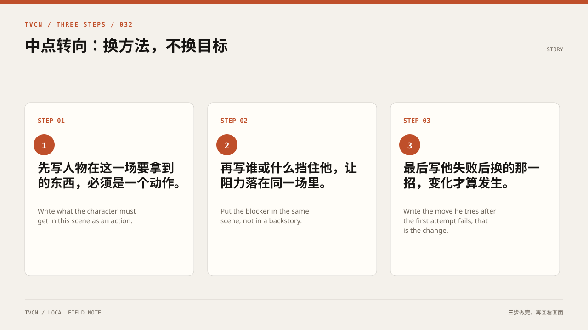

中点不是反转剧情，而是人物换一种办法去要同一个东西。

<!-- DIAGRAM_START -->
<h2>图解</h2>
<figure>
  
  <figcaption>把三步按顺序做完，再回看画面或文件。</figcaption>
</figure>
<!-- DIAGRAM_END -->
<h2>现场</h2>

中点写一张 A4：左栏写人物原来的办法，右栏写新办法，目标那一行不变。两栏各写三个具体动作，拍出来观众能看到方法换了。

<h2>怎么做</h2>

中点不是反转剧情，而是人物换一种办法去要同一个东西。
<ol><li>写一张 A4：左栏旧办法，右栏新办法，目标那一行不变。</li><li>两栏各写三个具体动作，能在画面上看出区别。</li><li>拍出来让观众看到方法换了，而不是只听他说“我变了”。</li></ol>
<h2>别踩</h2>

别把中点写成反转；目标没变，方法变了，才叫转向。

<h2>验收</h2>
<ul><li>中点前后目标那一行完全一样，没有偷偷换目标。</li><li>左右两栏各有三个可拍动作，方法差异看得见。</li><li>观众不看台词也能说出他换了什么办法。</li></ul>

<!-- DEEP_DIVE_START -->
## 深读

<strong>约 5 分钟。</strong> 中点不是反转，是人物换方法；目标还在，路不能再用。

### 中点先问方法

前半段用 A 方法追目标，中点发现 A 无效，必须换 B；换方法才有后半段。

如果中点只是“又遇到一个困难”，那不是中点，是重复；主角还在用同一种办法，观众已经知道结果。

新方法要让主角付出学习成本：求一个他不想求的人，学一个他不会的技能，放弃一个他珍惜的东西。

### 不要换目标

目标一换，观众前面的投入作废；换目标只适合喜剧或寓言，不适合大多数叙事。

可以换的是手段、盟友、地点、时间，不是“他其实想要另一样东西”。后者会让观众觉得被耍。

如果非换不可，让旧目标先被证明不可能，再让新目标从旧目标里长出来；观众要能看到因果关系。

### 中点要付代价

换方法要失去一点东西：钱、盟友、时间；没有代价，转折只是提醒。

代价要能被拍出来：卖掉车、签下欠条、跟朋友翻脸；不要只用一句“他很难过”带过。

中点之后，旧方法要彻底失效；如果后半段还能用 A 方法解决问题，中点就是假的。

### 把中点拍成一场戏

让主角当众用旧方法失败一次；观众看见，不用旁白解释。失败后他第一次用新方法，手要生，别一上来就熟练。

失败要有见证人：对手、同伴或客户。没有人看见的失败，观众会觉得可以重来。

### 五分钟练习：四行表

写下前半段的方法、它为什么失效、后半段的新方法、付出的代价；四行缺一行，重写。

再把新方法删掉，看后半段是否还能成立；还能成立，说明中点没有真正改变故事。

### 中点检查，十项
<ul><li>中点换的是方法不是目标</li><li>前半段的方法先有效</li><li>中点证明旧方法失效</li><li>新方法有学习成本</li><li>代价能拍出来</li><li>旧盟友或旧资源失去</li><li>后半段不能用旧方法</li><li>新方法从旧目标长出来</li><li>中点后节奏明显改变</li><li>四行表没有缺行</li></ul>
中点不是让故事更复杂，是让人物不能再走原来的路。

<!-- DEEP_DIVE_END -->
