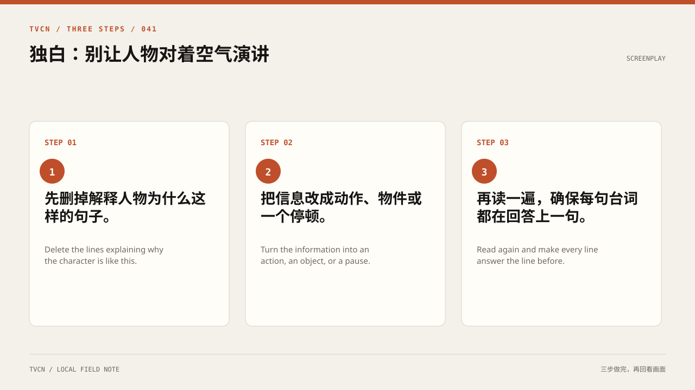

一个人对镜头说话，最怕变成朗读。先给他一个对象：不在场的人、镜子里的自己、一个物件；再给他一个动作：收拾、写字、开车。动作打断独白，观众才感到他在想，不是在背。

<!-- DIAGRAM_START -->
<h2>图解</h2>
<figure>
  
  <figcaption>看“先安排一个听众：正在收拾行李的人、背…”和“让人物一边说一边做一件打断自己的事”两处，判断人物想要的東西能不能用一个动作说出来。</figcaption>
</figure>
<!-- DIAGRAM_END -->
<section><h2 id="section-1">独白要有对象，也要有动作</h2>
把最想说的话留到动作之后。先说日常，再漏出真话，比从头煽情可信。
<h2 id="section-2">边界</h2>
独白不是解释剧情的工具。删掉所有“因为”“所以”，让观众从停顿和动作里补因果。
</section><section><h2 id="section-3">现场</h2>
独白前先安排一个听众：正在收拾行李的人、背对镜头的孩子。让人物一边说一边做一件打断自己的事。
</section><section><h2 id="section-4">怎么做</h2><ol><li>先安排一个听众：正在收拾行李的人、背对镜头的孩子。</li><li>让人物一边说一边做一件打断自己的事。</li><li>听众的反应要留在画面里，不能只是背景。</li></ol></section><section><h2 id="section-5">别踩</h2>
别让人物对着镜子或空气演讲；没有听众，独白就假。
</section><section><h2>判断</h2>
现场只认三个信号：
<ul><li>人物的目标能用一个动作说出来</li><li>障碍在同一场里升级，而不是换一个</li><li>删掉一句解释对白，冲突仍然成立</li></ul></section><section><h2>失败</h2>
下面三种做法会让页面上的细节白做：
<ul><li>人物想要什么没写清，场面只剩情绪</li><li>障碍靠巧合解决，人物没有做决定</li><li>对白把画面已经说明的事再说一遍</li></ul></section><section><h2>延伸</h2>
<strong>10 分钟练习：</strong>写一页 30 秒的场景，只保留“先安排一个听众：正在收拾行李的人、背…”和“让人物一边说一边做一件打断自己的事”，删掉所有解释；请一个人读一遍，问他能不能复述人物想要什么。
</section>
<h2>验收</h2><ul><li>画面里有一个走不开的听众，反应可见。</li><li>人物说话时在做一件打断自己的事。</li><li>删掉听众后独白明显变弱，说明关系真的在起作用。</li></ul>

> 意图分工：本页负责「独白：别让人物对着空气演讲」的可执行细节；同集群先读 <a href="https://story.tvcn.org/article/want-stakes/">欲望与赌注：输了会失去什么</a> 建立总判断，再回到本页。

<!-- INTENT_SCOPE -->

<!-- SOURCES_START -->
## 经验说明

经验说明：本页来自 6 次剧本围读与拍摄前排练，条件为3–8 页场景、单一主视角；页面讨论的具体对象是「独白：别让人物对着空气演讲」；不含外部实验室测试，条件变化时结论可能失效。
<!-- SOURCES_END -->

