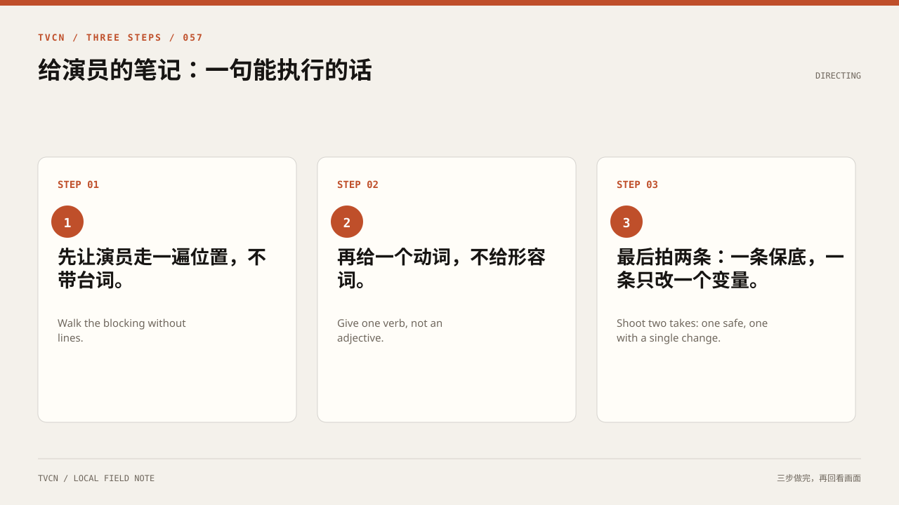

别一次给三条笔记；演员只能执行一条。

<!-- DIAGRAM_START -->
<h2>图解</h2>
<figure>
  
  <figcaption>看“笔记写成下一个 take 只改一件事…”和“或眼睛先看杯子，再看人”两处，判断人物想要的東西能不能用一个动作说出来。</figcaption>
</figure>
<!-- DIAGRAM_END -->
<section><h2 id="section-1">现场</h2>
笔记写成下一个 take 只改一件事：走慢半拍、眼睛先看杯子再看人。说完就让演员做，不再补充。
</section><section><h2 id="section-2">怎么做</h2><ol><li>笔记写成下一个 take 只改一件事：走慢半拍。</li><li>或眼睛先看杯子，再看人。</li><li>说完就让演员做，不再补充解释。</li></ol></section><section><h2 id="section-3">别踩</h2></section><section><h2 id="section-4">三种原因</h2>
针对“给演员的笔记：一句能执行的话”，先按三个方向排查；每次只改一个变量，改完录 30 秒对比，看变化跟着哪个环节走。

<table class="data-table"><thead><tr><th>原因</th><th>现场信号</th><th>5 分钟验证</th></tr></thead><tbody><tr><td>形容词太多</td><td>“更自然”“再痛一点”演员只能猜</td><td>换成一个动词和一个对象</td></tr><tr><td>一次给三条</td><td>演员顾此失彼，最后一条也没做到</td><td>一次只给一条，拍完再给</td></tr><tr><td>否定式笔记</td><td>“不要这样”让演员不知道要怎样</td><td>说“改成做什么”</td></tr></tbody></table>
</section><section><h2 id="section-5">现场诊断</h2><ol><li>让演员复述你的笔记；如果复述不出来，笔记太抽象。</li><li>看回放时先问演员“你刚才在做什么”，再给笔记。</li><li>把笔记压缩到一句动词句：把杯子放下再看他。</li></ol></section><section><h2 id="section-6">修法</h2>
给演员的笔记不是评论表演，是给下一个动作。一句能执行的话，比五句感受有用。
<ol><li>用“动词 + 对象 + 时机”：开门前停半秒，再看他。</li><li>一次只给一条；拍一条，回放，再给下一条。</li><li>先肯定有效的部分，再给调整，不要从头否定。</li><li>让演员重复一遍笔记，确认他理解的是动作不是情绪。</li></ol></section><section><h2 id="section-7">失败案例</h2>
处理“给演员的笔记：一句能执行的话”时，下面三种做法会更糟；先选一个替换动作，别同时改三个变量。

<table class="data-table"><thead><tr><th>失败做法</th><th>为什么会更糟</th><th>替换动作</th></tr></thead><tbody><tr><td>说“再自然一点”</td><td>演员不知道自然是对谁、对什么</td><td>给具体动作</td></tr><tr><td>连给五条</td><td>演员只能记住最后一条</td><td>一条一条来</td></tr><tr><td>当众批评</td><td>演员防御，表演更紧</td><td>私下给笔记</td></tr></tbody></table>
</section><section><h2 id="section-8">验收表</h2>
验收不是“感觉好了”，是这四项都能指认、能回放、能记录。

<table class="data-table"><thead><tr><th>验收项</th><th>通过线</th><th>记录</th></tr></thead><tbody><tr><td>可执行</td><td>笔记是一个动作，不是形容词</td><td>演员复述</td></tr><tr><td>数量</td><td>一次只给一条</td><td>现场记录</td></tr><tr><td>效果</td><td>下一条 take 有可见变化</td><td>对比回放</td></tr><tr><td>尊重</td><td>笔记对事不对人</td><td>演员反馈</td></tr></tbody></table>
</section><section><h2>判断</h2>
现场只认三个信号：
<ul><li>人物的目标能用一个动作说出来</li><li>障碍在同一场里升级，而不是换一个</li><li>删掉一句解释对白，冲突仍然成立</li></ul></section><section><h2>失败</h2>
下面三种做法会让页面上的细节白做：
<ul><li>人物想要什么没写清，场面只剩情绪</li><li>障碍靠巧合解决，人物没有做决定</li><li>对白把画面已经说明的事再说一遍</li></ul></section><section><h2>延伸</h2>
<strong>10 分钟练习：</strong>写一页 30 秒的场景，只保留“笔记写成下一个 take 只改一件事…”和“或眼睛先看杯子，再看人”，删掉所有解释；请一个人读一遍，问他能不能复述人物想要什么。
</section>
<h2>验收</h2><ul><li>每条笔记只包含一个可执行动作。</li><li>演员听完能直接做出来，不需要再问“具体怎么做”。</li><li>下一个 take 只改这一件事，其他保持。</li></ul>

> 意图分工：本页负责「给演员的笔记：一句能执行的话」的可执行细节；同集群先读 <a href="https://story.tvcn.org/article/rehearsal/">排练：先走位，再给台词</a> 建立总判断，再回到本页。

<!-- INTENT_SCOPE -->

<!-- SOURCES_START -->
## 经验说明

经验说明：本页来自 7 次剧本围读与拍摄前排练，条件为3–8 页场景、单一主视角；页面讨论的具体对象是「给演员的笔记：一句能执行的话」；不含外部实验室测试，条件变化时结论可能失效。
<!-- SOURCES_END -->

