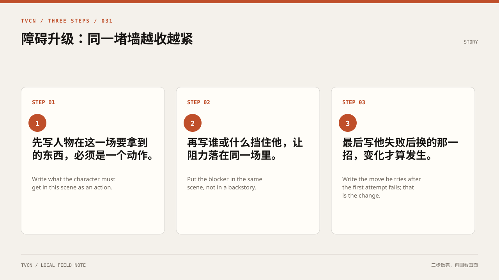

同一个障碍连撞三次，每次代价更高，观众才会觉得人物真的被逼到墙角。

<!-- DIAGRAM_START -->
<h2>图解</h2>
<figure>
  
  <figcaption>把三步按顺序做完，再回看画面或文件。</figcaption>
</figure>
<!-- DIAGRAM_END -->
<h2>现场</h2>

同一场设三次阻力：第一次一句话挡回，第二次要付出时间，第三次要牺牲一个人。每次都比上次多失去一点。

<h2>怎么做</h2>

同一个障碍连撞三次，每次代价更高，观众才会觉得人物真的被逼到墙角。
<ol><li>第一次用一句话挡回，代价最小。</li><li>第二次要付出时间，比如白等一天。</li><li>第三次要牺牲一个人或一个关系，逼出选择。</li></ol>
<h2>别踩</h2>

别每次都换新障碍；不升级，压力就不会累积。

<h2>验收</h2>
<ul><li>三次阻力来自同一个障碍，不是三个新麻烦。</li><li>每次代价都比上一次高：一句话、一天、一个人。</li><li>第三次之后人物必须做选择，不能原路返回。</li></ul>
