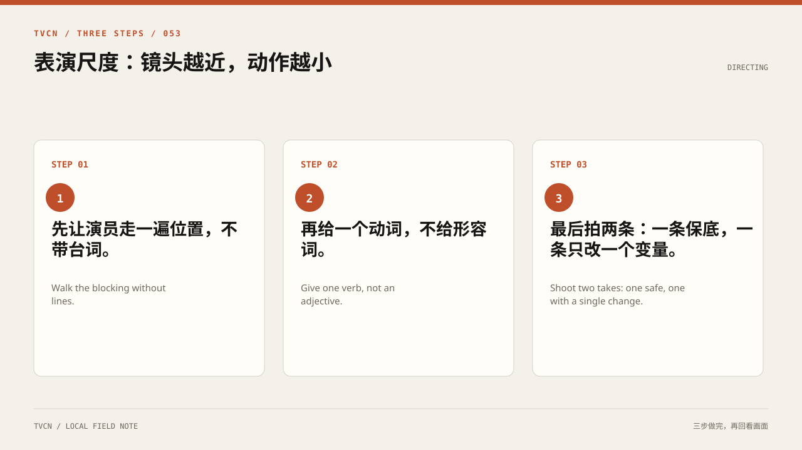

镜头越近，动作越小；远景里刚好的手势，近景里会像演戏。

<!-- DIAGRAM_START -->
<h2>图解</h2>
<figure>
  
  <figcaption>把三步按顺序做完，再回看画面或文件。</figcaption>
</figure>
<!-- DIAGRAM_END -->
<h2>现场</h2>

远景排练用大动作，近景前让演员把动作减半；拍近景时先拍一条手部特写，确认动作没有表演感。

<h2>怎么做</h2>

镜头越近，动作越小；远景里刚好的手势，近景里会像演戏。
<ol><li>远景排练用大动作，让空间关系成立。</li><li>近景前让演员把动作减半。</li><li>先拍一条手部特写，确认动作没有表演感。</li></ol>
<h2>别踩</h2>

别用同一个动作尺度拍所有景别；近景会把表演放大。

<h2>验收</h2>
<ul><li>远景和近景的动作幅度明显不同，近景减半。</li><li>手部特写没有表演感，关节和力度自然。</li><li>把近景动作放回远景会显得太小，说明尺度调对了。</li></ul>
