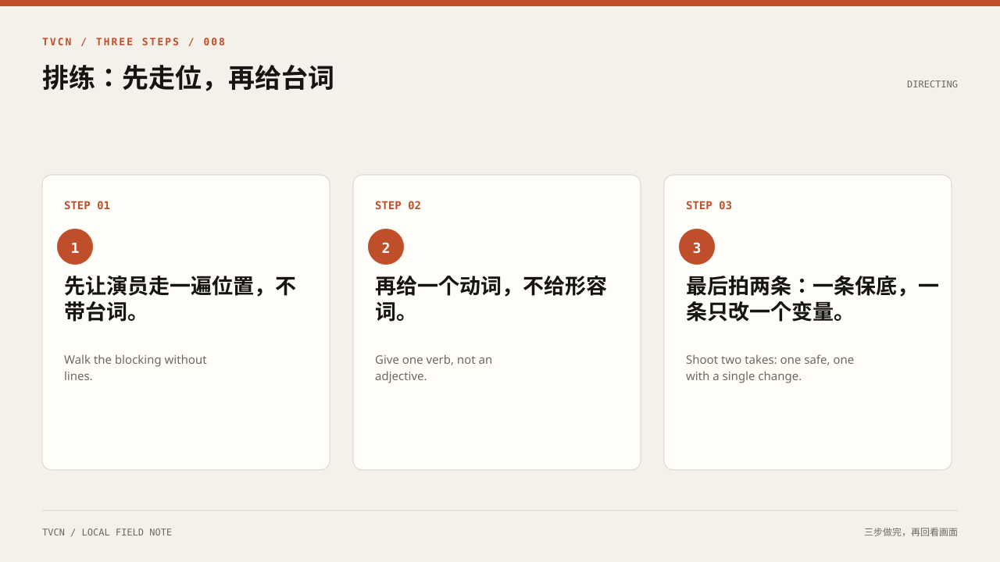

现场排练只做三件事：走位、道具交接、台词接点。不要从头到尾演一遍，把情绪用光；把力气留给正式条。

<!-- DIAGRAM_START -->
<h2>图解</h2>
<figure>
  
  <figcaption>看“前 20 分钟只走位，用胶带标门口、…”和“演员不带台词走三遍，只走动作和停顿”两处，判断人物想要的東西能不能用一个动作说出来。</figcaption>
</figure>
<!-- DIAGRAM_END -->
<section><h2 id="section-1">排练走动作，不走完整表演</h2>
让摄影和录音一起走一遍，确认机位、麦克风、光线不会被挡住。排练发现的空间问题，比表演问题更值钱。
<h2 id="section-2">边界</h2>
排练不是正式拍摄。不要用排练条当素材；演员知道还在排练，动作和注意力都不一样。
</section><section><h2 id="section-3">现场</h2>
排练前 20 分钟只走位：用胶带标门口、椅子和摄影机；演员不带台词走三遍，第三遍才加台词。
</section><section><h2 id="section-4">怎么做</h2><ol><li>前 20 分钟只走位，用胶带标门口、椅子和摄影机。</li><li>演员不带台词走三遍，只走动作和停顿。</li><li>第三遍才加台词，确认话落在已经成立的位置上。</li></ol></section><section><h2 id="section-5">别踩</h2>
别在监视器后面喊“自然一点”；演员不知道那是什么意思。
</section><section><h2>判断</h2>
现场只认三个信号：
<ul><li>人物的目标能用一个动作说出来</li><li>障碍在同一场里升级，而不是换一个</li><li>删掉一句解释对白，冲突仍然成立</li></ul></section><section><h2>失败</h2>
下面三种做法会让页面上的细节白做：
<ul><li>人物想要什么没写清，场面只剩情绪</li><li>障碍靠巧合解决，人物没有做决定</li><li>对白把画面已经说明的事再说一遍</li></ul></section><section><h2>延伸</h2>
<strong>10 分钟练习：</strong>写一页 30 秒的场景，只保留“前 20 分钟只走位，用胶带标门口、…”和“演员不带台词走三遍，只走动作和停顿”，删掉所有解释；请一个人读一遍，问他能不能复述人物想要什么。
</section>
<h2>验收</h2><ul><li>前两遍没有台词，演员只走位置和动作。</li><li>第三遍加台词后，停顿仍落在动作上。</li><li>演员能说出自己在这一场一直想做什么。</li></ul>

<!-- DEEP_DIVE_START -->
## 深读

<strong>约 5 分钟。</strong> 排练不是把台词念顺，是让身体先记住空间和动作。

### 先走位，后台词

不带台词走一遍，标起点、转身、坐下、碰道具；演员知道身体去哪，台词才有地方落。

走位时不要拿手机拍，先让演员自己找到节奏；拍下来的是参考，不是表演。

### 只给动词

不要“你更伤心一点”，给“你把杯子放下，手停在桌上两秒”；动作可执行，表演才有依据。

一次只改一个动作；改三个，演员会不知道哪一个是对的。

### 排练拍广角

拍一条广角回放，看遮挡、出画、走位重复；广角不是成片，是检查工具。

排练最后一遍按正式机位走，但不要开机；让演员知道机器在哪，不要到现场才躲。

### 排练不是演给导演看

排练时导演少说话，让演员自己走两遍；第三遍再给一个动词。演员找到的身体记忆，比导演的口令可靠。

把手机放远，不要每遍都拍；拍太多，演员会开始为镜头表演。

最后一遍按正式机位走，但不带妆、不开机；让演员知道机器在哪，开机时就不会躲。排练结束只记三个问题：谁被挡、谁出画、哪个动作还不敢做。

如果演员问“我该是什么情绪”，让他做一个动作，不要给形容词。

### 排练结束的最后一个动作

让演员不带台词再做一次开场动作，只做身体；做完问他“手想放在哪”。他的答案通常比走位图更准。

把答案写进走位图，不要只记在脑子里；第二天换场地，身体记忆会丢一半。

### 排练结束，十项确认
<ul><li>演员不拿台词走了一遍</li><li>起点、终点、转身点标好</li><li>坐下和起身都试过</li><li>每个道具都碰过一次</li><li>只给动词不给形容词</li><li>一次只改一个动作</li><li>广角回放看过遮挡</li><li>确认演员不出画</li><li>最后按正式机位走一遍</li><li>走位图拍照存档</li></ul>
排练把意外留在排练，不留在开机。

<!-- DEEP_DIVE_END -->
