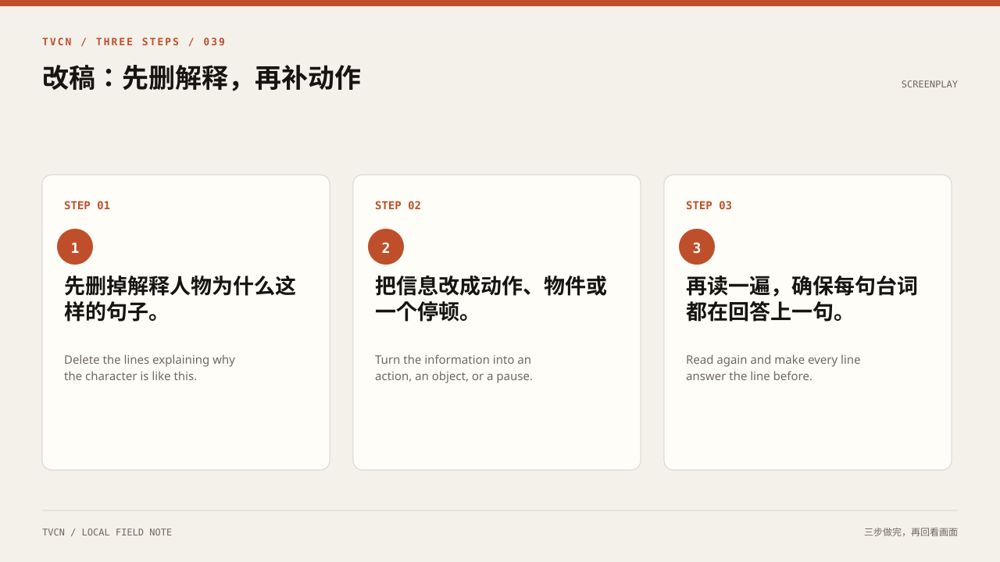

别用解释补漏洞；解释越多，动作越少。

<!-- DIAGRAM_START -->
<h2>图解</h2>
<figure>
  
  <figcaption>看“先搜“因为、所以、感到”，每找到一个…”和“把删掉的信息换成一个动作或物件”两处，判断人物想要的東西能不能用一个动作说出来。</figcaption>
</figure>
<!-- DIAGRAM_END -->
<section><h2 id="section-1">现场</h2>
改稿时先搜因为、所以、感到，每找到一个就删掉，换成一个动作或物件；一页最多留一个解释句。
</section><section><h2 id="section-2">怎么做</h2><ol><li>先搜“因为、所以、感到”，每找到一个就删掉。</li><li>把删掉的信息换成一个动作或物件。</li><li>一页最多留一个解释句，其余都让画面说。</li></ol></section><section><h2 id="section-3">别踩</h2></section><section><h2 id="section-4">三种原因</h2>
针对“改稿：先删解释，再补动作”，先按三个方向排查；每次只改一个变量，改完录 30 秒对比，看变化跟着哪个环节走。

<table class="data-table"><thead><tr><th>原因</th><th>现场信号</th><th>5 分钟验证</th></tr></thead><tbody><tr><td>解释主题</td><td>人物说出“我学会了放下”，戏就没有了</td><td>把主题改成动作和代价</td></tr><tr><td>重复信息</td><td>同一件事说三遍，观众提前走</td><td>每场只保留一个新信息</td></tr><tr><td>缺动作</td><td>整页都在说，没有人物做事</td><td>每页至少一个动作改变关系</td></tr></tbody></table>
</section><section><h2 id="section-5">现场诊断</h2><ol><li>逐页标“说”与“做”；如果一页全是说，删或改。</li><li>用一句话写每场的变化；写不出就是没变化。</li><li>把最后一句删掉，看前一句是否还能成立。</li></ol></section><section><h2 id="section-6">修法</h2>
改稿不是删字数，是让每一页都发生一个变化。先删解释，再把信息藏进动作。
<ol><li>删掉角色解释自己为什么这样的台词。</li><li>把背景信息放进道具、空间或动作：一张旧照片、一扇锁着的门。</li><li>每场结尾让关系或信息发生变化，不要停在原样。</li><li>把最想说的主题留到最后一个动作，不要让人物说。</li></ol></section><section><h2 id="section-7">失败案例</h2>
处理“改稿：先删解释，再补动作”时，下面三种做法会更糟；先选一个替换动作，别同时改三个变量。

<table class="data-table"><thead><tr><th>失败做法</th><th>为什么会更糟</th><th>替换动作</th></tr></thead><tbody><tr><td>只删字数</td><td>页面短了，变化还是没有</td><td>按场检查变化</td></tr><tr><td>加更多事件</td><td>事件堆叠，人物没有选择</td><td>每个事件必须逼一个选择</td></tr><tr><td>把解释改成旁白</td><td>信息还在，只是换了嘴</td><td>改成可见动作</td></tr></tbody></table>
</section><section><h2 id="section-8">验收表</h2>
验收不是“感觉好了”，是这四项都能指认、能回放、能记录。

<table class="data-table"><thead><tr><th>验收项</th><th>通过线</th><th>记录</th></tr></thead><tbody><tr><td>每场变化</td><td>每场能写出一句“从 X 到 Y”</td><td>逐场表</td></tr><tr><td>说/做比例</td><td>每页至少一个动作</td><td>页面标记</td></tr><tr><td>解释</td><td>角色不解释自己的心理</td><td>搜索“因为/其实”</td></tr><tr><td>结尾</td><td>最后动作承担主题</td><td>读最后三页</td></tr></tbody></table>
</section><section><h2>判断</h2>
现场只认三个信号：
<ul><li>人物的目标能用一个动作说出来</li><li>障碍在同一场里升级，而不是换一个</li><li>删掉一句解释对白，冲突仍然成立</li></ul></section><section><h2>失败</h2>
下面三种做法会让页面上的细节白做：
<ul><li>人物想要什么没写清，场面只剩情绪</li><li>障碍靠巧合解决，人物没有做决定</li><li>对白把画面已经说明的事再说一遍</li></ul></section><section><h2>延伸</h2>
<strong>10 分钟练习：</strong>写一页 30 秒的场景，只保留“先搜“因为、所以、感到”，每找到一个…”和“把删掉的信息换成一个动作或物件”，删掉所有解释；请一个人读一遍，问他能不能复述人物想要什么。
</section>
<h2>验收</h2><ul><li>全文搜不到“因为、所以、感到”这类解释词。</li><li>删掉的信息都换成了可拍的动作或物件。</li><li>一页最多只有一个解释句，其余靠画面成立。</li></ul>

<!-- SOURCES_START -->
## 经验说明

经验说明：本页来自 4 次剧本围读与拍摄前排练，条件为3–8 页场景、单一主视角；页面讨论的具体对象是「改稿：先删解释，再补动作」；不含外部实验室测试，条件变化时结论可能失效。
<!-- SOURCES_END -->

