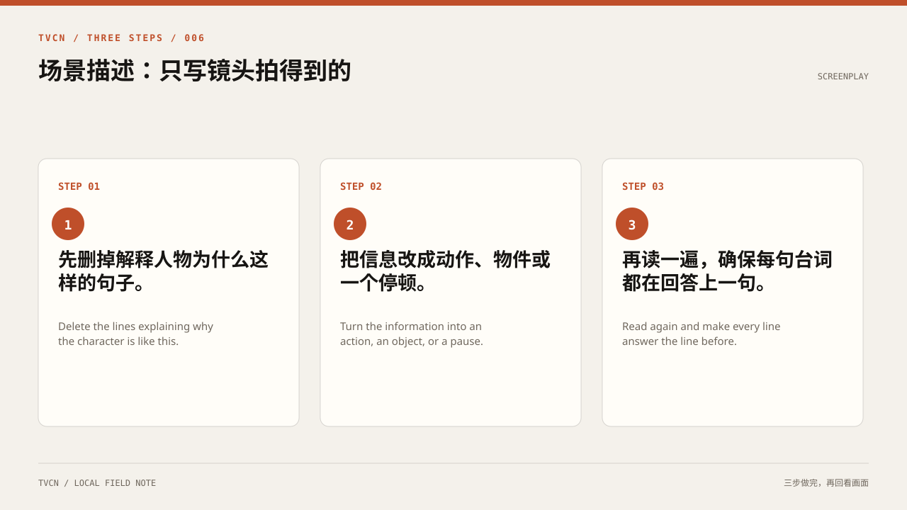

场景描述只写镜头拍得到的东西：光、动作、物件、声音；心理活动留给演员。

<!-- DIAGRAM_START -->
<h2>图解</h2>
<figure>
  
  <figcaption>把三步按顺序做完，再回看画面或文件。</figcaption>
</figure>
<!-- DIAGRAM_END -->
<h2>现场</h2>

把一页场景改成只写可见可听：谁坐在哪、手里拿什么、窗外什么声。删掉他很焦虑，让演员用抖腿或反复看表演出来。

<h2>怎么做</h2>

场景描述只写镜头拍得到的东西：光、动作、物件、声音；心理活动留给演员。
<ol><li>把一页场景改成只写可见可听：谁坐在哪、手里拿什么、窗外什么声。</li><li>删掉“他很焦虑”，换成一个动作：抖腿、反复看门。</li><li>读一遍，确认每句都能被摄影机或录音机拍到。</li></ol>
<h2>别踩</h2>

别让人物说出主题；主题一出口，戏就死了。

<h2>验收</h2>
<ul><li>每句描述都能被拍到或录到，没有心理独白。</li><li>焦虑、犹豫这类状态都换成了具体动作。</li><li>摄影和录音读一页，能标出机位和该收的声音。</li></ul>

<!-- DEEP_DIVE_START -->
## 深读

<strong>约 5 分钟。</strong> 场景描述只写镜头拍得到的东西；观众看见什么，才是剧本写了什么。

### 删掉心理形容词

不要“她很焦虑”，写“她拧开瓶盖又拧回去，水没喝”；动作让演员有得演，也让摄影有得拍。

不要写“气氛压抑”，写“窗关着，桌上两只杯子，一只还在冒气”。

### 写空间和道具

房间里的两只杯子、半开的纸箱、沙发坐痕，比一句“房间很乱”有用；道具要能被镜头看见、被演员碰到。

道具第一次出现就要有用；如果只是背景，删掉，别让美术白忙。

### 一段只写一个动作

开门、坐下、说话分三段；一段塞三个动作，演员会赶，剪辑也没有接点。

动作之间留一个空行，让导演和演员都能看见呼吸。

### 让演员读得懂

写完自己读一遍，问三个问题：手放哪、脚往哪走、眼睛看谁。答不出来，演员就得现场猜。

把抽象词换成能拍的名词和动词：杯子、门缝、走廊、放下、停两秒。

如果一段描述超过三行，通常塞了两个动作；拆开，让每段只有一个动作。给道具写清位置和状态：在桌上、在手里、还是在地上；演员不用问美术。

每换一个地点，重新写一次光线和声音；不要用“同上”省字。导演和摄影理解不一致时，回去改描述，不要在现场吵。

### 三行检查

每段读三行：第一行有没有动作，第二行有没有空间，第三行有没有声音或光线。三样都没有，这段就只是说明。

删掉“然后”和“开始”，动作自己会按顺序发生；留一个空行，剪辑和演员都能呼吸。

### 场景描述，十项检查
<ul><li>每段只写一个动作</li><li>没有心理形容词</li><li>没有“气氛”这类空词</li><li>每个动作镜头拍得到</li><li>道具第一次出现就有用</li><li>空间关系写清楚</li><li>光线和声音能看见或听见</li><li>动作之间留空行</li><li>人名第一次出现写全</li><li>读一遍，演员知道手放哪</li></ul>
场景描述不是散文，是给镜头和演员的施工图。

<!-- DEEP_DIVE_END -->
