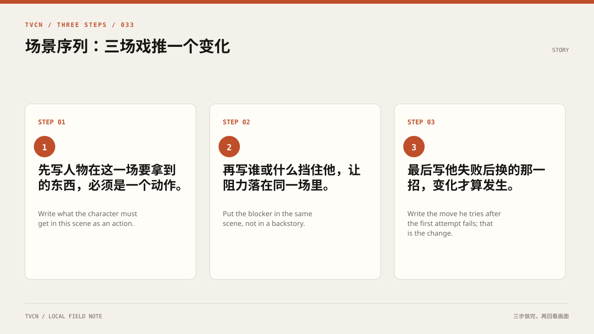

一场戏只完成一个变化，三场戏连起来才推得动一个段落。

<!-- DIAGRAM_START -->
<h2>图解</h2>
<figure>
  
  <figcaption>把三步按顺序做完，再回看画面或文件。</figcaption>
</figure>
<!-- DIAGRAM_END -->
<h2>现场</h2>

把段落拆成三场：第一场提出目标，第二场让目标受阻，第三场逼出一个选择。每场结尾必须改变下一场的条件。

<h2>怎么做</h2>

一场戏只完成一个变化，三场戏连起来才推得动一个段落。
<ol><li>第一场提出目标，让观众知道人物要什么。</li><li>第二场让目标受阻，条件变坏。</li><li>第三场逼出一个选择，并改变下一场的条件。</li></ol>
<h2>别踩</h2>

别让三场戏都在重复同一个信息；没有条件变化，段落推不动。

<h2>验收</h2>
<ul><li>三场各有一个变化，能用“从什么变成什么”说清。</li><li>每场结尾都改变了下一场的条件。</li><li>删掉任意一场，段落会断，而不是只少一点热闹。</li></ul>

<!-- DEEP_DIVE_START -->
## 深读

<strong>约 6 分钟。</strong> 一场戏只推一个变化；三场戏连起来，才叫一个序列。

### 一场戏只回答一个问题

谁想要什么、被什么挡住、最后做了什么选择；三个问题答完，这场就该结束。多出来的信息留给下一场。

如果一场戏结束时，人物的处境和开头一样，这场就只是重复；删掉它，观众不会少知道什么。

一场戏只留一个主问题；支线可以出现，但不要在同一场里抢同一个答案。

### 三场戏一条变化线

第一场建立常态，第二场打破，第三场做选择；每场结尾都要改变下一场的条件。

第一场结束时，观众要知道“他平常怎么活”；第二场结束时，要知道“旧办法为什么不行”；第三场结束时，要知道“他选了哪条新路”。

三场之间不要用字幕跳时间；用一个重复的道具、一句重复的话或一个相同的动作，把变化串起来。

### 序列不是三场同义反复

如果三场都在吵同一件事，删掉一场；变化不是音量变大，是方法变了。

第一场他求人，第二场他威胁，第三场他放弃；三种方法，才叫升级。三场都在求人，只是重复。

每一场给人物一个新的限制：时间、钱、关系、体力；限制变了，选择才会变。

### 五分钟练习：三句话连读

拿三场戏各写一句话：他想要、挡住、选择；三句连起来读，若第二句和第一句同义，重写第二场。

再把第三场的选择换成相反选择，看故事是否还成立；成立，说明前面的压力不够。

### 场景序列，十项检查
<ul><li>每场只回答一个主问题</li><li>结尾处境和开头不同</li><li>第一场建立常态</li><li>第二场打破旧办法</li><li>第三场做出新选择</li><li>每场结尾改变下一场条件</li><li>三场方法不一样</li><li>每场加一个新限制</li><li>用重复道具或动作串联</li><li>三句话连读不重复</li></ul>
序列不是三场戏排队，是三场戏互相逼出下一步。

<!-- DEEP_DIVE_END -->
