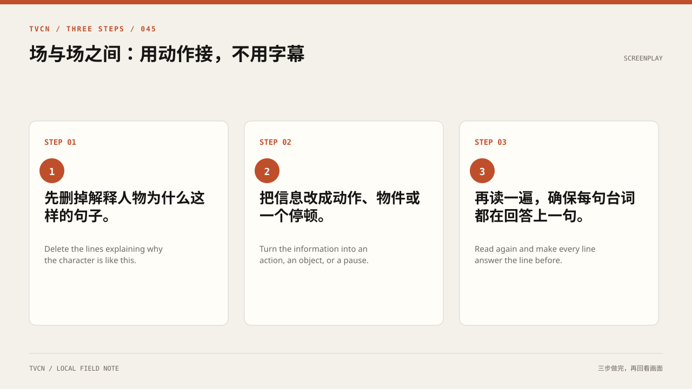

场与场之间用动作、声音或物件接，别用字幕卡解释“三天后”。

<!-- DIAGRAM_START -->
<h2>图解</h2>
<figure>
  
  <figcaption>把三步按顺序做完，再回看画面或文件。</figcaption>
</figure>
<!-- DIAGRAM_END -->
<h2>现场</h2>

场与场之间找一个共同动作：上一场关门，下一场开门；上一场拿起杯子，下一场放下。用动作接时间。

<h2>怎么做</h2>

场与场之间用动作、声音或物件接，别用字幕卡解释“三天后”。
<ol><li>找共同动作：上一场关门，下一场开门。</li><li>或找共同物件：上一场拿起杯子，下一场放下。</li><li>用声音先到或后到，把两个空间连起来，不用字幕卡。</li></ol>
<h2>别踩</h2>

别用字幕卡解释时间；能用动作接，就不要写字。

<h2>验收</h2>
<ul><li>相邻两场至少有一个共同动作、物件或声音。</li><li>时间跳跃不靠字幕卡也能看懂。</li><li>把字幕卡拿掉，观众仍能说出过了多久或到了哪里。</li></ul>
