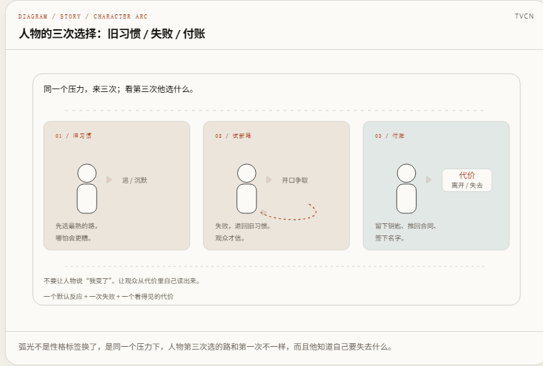

<!-- DIAGRAM_START -->
## 图解

<figure>
  
  <figcaption>弧光不是性格标签换了，是同一个压力下，人物第三次选的路和第一次不一样，而且他知道自己要失去什么。</figcaption>
</figure>
<!-- DIAGRAM_END -->

人物弧光不是“她变得更勇敢了”。是同一个压力再来时，她做了不一样的选择，而且付了代价。

## 先给人物一个默认反应

压力一来，他先做什么：逃、讨好、控制、沉默、开玩笑。这就是起点。不用写人物小传，写三个场景：同一类压力，第一次他怎么反应，第二次怎么反应，第三次怎么反应。

第一次让他选最熟悉的办法，哪怕这个办法会坏事。观众要先认识他的旧习惯，后面的变化才有分量。

不要用形容词推进。不要写“她逐渐变得坚定”，写她在门口停住、把行李箱推回屋里、第一次没有道歉。动作变了，人物就变了。

## 中间必须失败一次

改变不是一次决定。中点让他试新选择，失败，退回旧习惯。观众才会信，因为现实里人就是这样。

例子：她第一次在会议上开口争取，被当众驳回；下一场，她又沉默了。这个后退不是重复，是让观众看见旧习惯有多重。

弧光不是直线，是退一步再往前。没有失败，最后的选择会像编剧发的奖品，不像人物自己挣来的。

## 最后的选择要付账

最后选新路，必须失去旧东西：安全、关系、面子、一份工作。不要让他发表演讲，也不要让旁人夸他变了。用动作结账：把钥匙留下、把合同推回去、把行李箱提进屋、签下名字。

观众从代价知道人物变了，不是从台词知道。代价越具体，弧光越可信。

## 检查

- 人物有一个能重复出现的默认反应。
- 中点的改变失败过一次，人物退回了旧习惯。
- 最后的选择付出了看得见的代价，不靠台词说明。

> 意图分工：本页负责「人物弧光：不是变好，是选择变了」的可执行细节；同集群先读 <a href="https://story.tvcn.org/article/want-stakes/">欲望与赌注：输了会失去什么</a> 建立总判断，再回到本页。

<!-- INTENT_SCOPE -->

<!-- SOURCES_START -->
## 经验说明

经验说明：本页来自 6 次剧本围读与拍摄前排练，条件为3–8 页场景、单一主视角；页面讨论的具体对象是「人物弧光：不是变好，是选择变了」；不含外部实验室测试，条件变化时结论可能失效。
<!-- SOURCES_END -->

