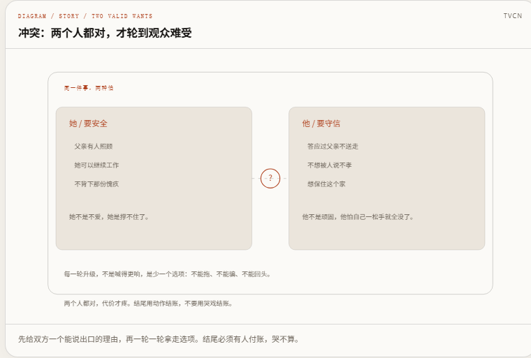

<!-- DIAGRAM_START -->
## 图解

<figure>
  
  <figcaption>先给双方一个能说出口的理由，再一轮一轮拿走选项。结尾必须有人付账，哭不算。</figcaption>
</figure>
<!-- DIAGRAM_END -->

吵架不等于冲突。真正的冲突，是两个人要的东西都合理，但只能有一个结果。

## 先给双方一个能说出口的理由

反派最容易写，也最没劲。把两个人都写成“为了自己好”，冲突就变成抢东西；把两个人都写成“为了一个别人”，观众才会难受。

例子：她要把父亲送去养老院，因为她一个人照顾不动，再拖下去工作也要丢；他要接父亲回家，因为他答应过“不送走”。两个理由都成立，谁让步都要失去一点东西。

写的时候给每个人一句能对朋友说出口的话。说不出口的理由，多半是编剧为了方便硬塞的。

## 冲突不是喊，是选择变窄

吵得更大声，不叫升级。真正的升级，是同一件事越来越拖不起：先还能商量，再变成今晚必须决定，最后变成签了字就收不回。

用时间、钱、第三个人来压，不要靠不断加新人物。每翻一轮，拿掉一个选项：不能拖、不能骗、不能回头。人物的选择越少，观众越能感到疼。

如果两个人还有第三条路可走，这场冲突就还没到火候。

## 结尾要有人付账

冲突结束，必须有人付出代价。赢的人失去了什么，输的人保住了什么，都要看得见。不要用一场哭戏代替代价，哭完什么都没变，观众不会记得。

最后一个动作就够了：签字、关门、把钥匙放在桌上、把那只鞋放回柜子。观众从那一个动作里，知道谁赢了，也知道谁没赢。

## 检查

- 双方的理由都能用一句话说清，而且都成立。
- 每一轮冲突都拿掉一个选项，而不是只提高音量。
- 结尾有人付出看得见的代价。

> 意图分工：本页负责「冲突：两个人都得有道理」的可执行细节；同集群先读 <a href="https://story.tvcn.org/article/midpoint-turn/">中点转向：换方法，不换目标</a> 建立总判断，再回到本页。

<!-- INTENT_SCOPE -->

<!-- SOURCES_START -->
## 经验说明

经验说明：本页来自 5 次剧本围读与拍摄前排练，条件为3–8 页场景、单一主视角；页面讨论的具体对象是「冲突：两个人都得有道理」；不含外部实验室测试，条件变化时结论可能失效。
<!-- SOURCES_END -->

