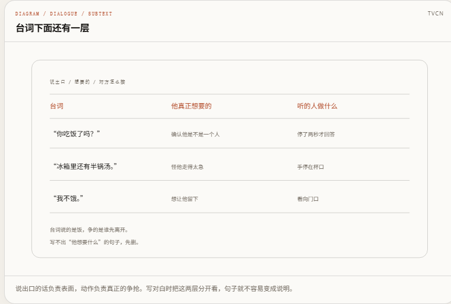

<!-- DIAGRAM_START -->
## 图解

<figure>
  
  <figcaption>说出口的话负责表面，动作负责真正的争抢。写对白时把这两层分开看，句子就不容易变成说明。</figcaption>
</figure>
<!-- DIAGRAM_END -->

## 每句都在争一个东西

写对白之前，先在每句话旁边标一个动作：他要对方承认、道歉、留下、闭嘴、给钱，还是只是想让房间安静下来。标不出动作的句子，多半是废话。

两个人都想要同一件东西，对白才有张力。一个人问“你吃饭了吗”，另一个人听成“你为什么没等我”。台词说的是饭，争的是谁先离开。

## 把说明书删掉

“你知道我从小……”这种句子是给观众的解释，不是人物此刻会说的话。人物在吵架时不会停下来交代背景，他只会拿最疼的地方戳对方。

把背景拆成能看见的东西：一张没带走的照片、一只还留在门口的箱子、一个人把烟按进没洗的盘子。观众看见这些，就不需要你再说一遍。

如果必须交代，让人物在争的过程里说漏。说漏才有代价，坐下来总结没有。

## 听的人比说的人重要

对白不是台词接力。一个人说完，另一个人的反应才是这场戏的温度：他停了几秒，有没有看对方，手在桌面上做什么。

拍的时候给听的人一个单独镜头。哪怕他一个字不说，观众也会从他的脸上读出刚才那句话有多重。

沉默也是台词。该回的话没回，观众会替他说；这时候切走，比再补一句解释有力。

## 检查

- 每句台词旁边能写出人物想要的动作。
- 解释性台词已经删掉，背景由画面或动作接住。
- 听的人有反应镜头，沉默有作用。
