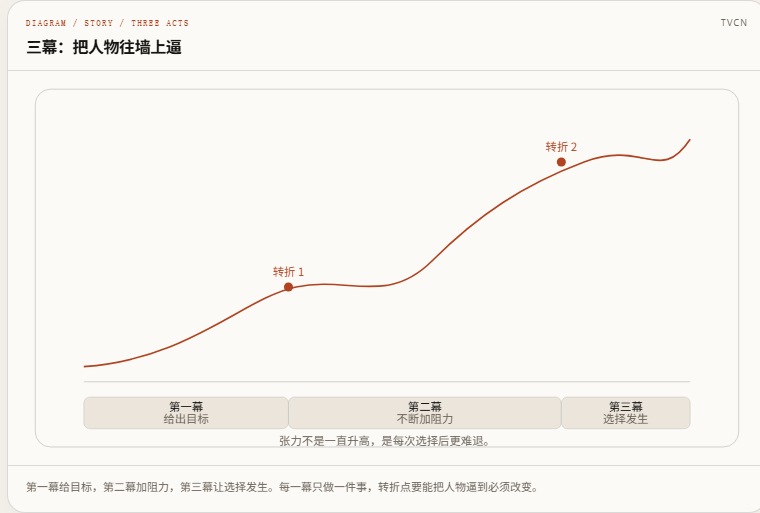

<!-- DIAGRAM_START -->
## 图解

<figure>
  
  <figcaption>第一幕给目标，第二幕加阻力，第三幕让选择发生。每一幕只做一件事，转折点要能把人物逼到必须改变。</figcaption>
</figure>
<!-- DIAGRAM_END -->

## 第一幕只负责让人物出发

第一幕不需要世界观，只需要三件事：这个人想要什么、什么挡着他、他决定怎么办。结尾是一个动作，不是一段解释。

短片的前四分之一就该完成这件事。观众如果到一半还不知道人物要什么，后面再漂亮也只是画面。

## 第二幕不是变复杂，是加压

第二幕最容易写坏：不断加新人物、新支线、新反转。短片不需要更多东西，只需要同一个障碍越来越难绕。

中点让人物换一次方法：求人、撒谎、妥协、反抗。方法变了，压力才真的上升。

## 第三幕只回答一个问题

第三幕只回答：他愿意付出什么代价。不要再引入新信息、新人物、新场景。结尾可以输，可以赢，但不能含糊。

最后一个镜头停在选择之后，不要加旁白总结。观众自己补上的那句，比写出来的更有效。

## 3 条验收

- 能用一句话说出人物想要什么、被什么挡住。
- 中点前后，人物换了方法，而不是换了目标。
- 第三幕没有出现新人物或新规则。

<!-- V11_DEEPEN -->

> 意图分工：本页负责「三幕片的骨架：把人物往墙上逼」的可执行细节；同集群先读 <a href="https://story.tvcn.org/article/midpoint-turn/">中点转向：换方法，不换目标</a> 建立总判断，再回到本页。

<!-- INTENT_SCOPE -->

<section><h2>边界</h2>
本页只解决「三幕片的骨架：把人物往墙上逼」这一个问题；不替代 旁白：别替观众总结、欲望与赌注：输了会失去什么、构图：先让观众知道看哪里。如果现场问题属于后者，先读对应页，不要在本页继续加参数。
</section>
<!-- SOURCES_START -->
## 参考与延伸阅读

- [S41] [美国编剧工会：合同与署名资源](https://www.wga.org/) — 2026-11-26 访问。用于核对「第一幕只负责让人物出发」一节的术语/方法/规则（WGA 合同与署名资源，不是中国劳动法）；不核对其中由本页经验得出的数字、型号与现场结论，也不替代测试。
- [S42] [Pixar in a Box：叙事课程](https://www.khanacademy.org/partner-content/pixar) — 2026-11-26 访问。用于核对「第二幕不是变复杂，是加压」一节的术语/方法/规则（Pixar 叙事课程，不是项目报价）；不核对其中由本页经验得出的数字、型号与现场结论，也不替代测试。
<!-- SOURCES_END -->

