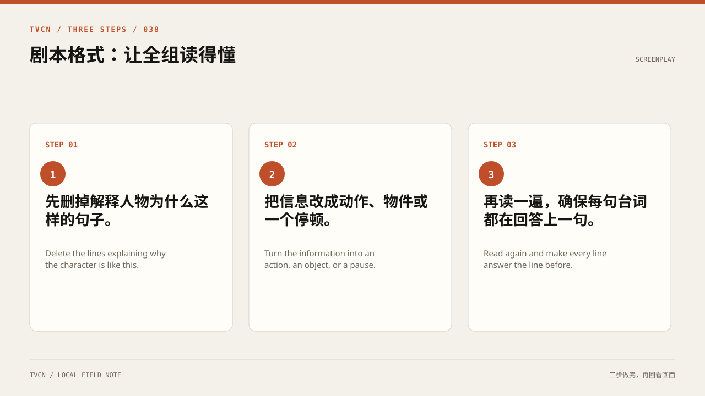

剧本格式不是给文学奖看的，它要让摄影、录音和剪辑一眼找到信息。

<!-- DIAGRAM_START -->
<h2>图解</h2>
<figure>
  
  <figcaption>把三步按顺序做完，再回看画面或文件。</figcaption>
</figure>
<!-- DIAGRAM_END -->
<h2>现场</h2>

剧本每场开头写清内外景、地点、时间；动作段落不超过四行；第一次出现的人物名全大写。让录音知道什么时候开门。

<h2>怎么做</h2>

剧本格式不是给文学奖看的，它要让摄影、录音和剪辑一眼找到信息。
<ol><li>每场开头写清内外景、地点、时间。</li><li>动作段落不超过四行，第一次出现的人物名全大写。</li><li>把开门、电话、脚步等声音提示写进行动里，让录音知道收什么。</li></ol>
<h2>别踩</h2>

别把剧本写成小说；全组找不到场号和声音提示，现场就会漏。

<h2>验收</h2>
<ul><li>每场都有内外景、地点和时间，场号连续。</li><li>动作段落不超过四行，人物首次出现是大写。</li><li>录音能从剧本里标出至少三个该收的声音。</li></ul>

<!-- DEEP_DIVE_START -->
## 深读

<strong>约 6 分钟。</strong> 现场手册告诉你怎么写；这一层讲一张剧本怎么让五个人同时开工，以及改稿时到底该删哪几类字。

### 一页剧本，五个人同时要用

导演从剧本里找动作，摄影找空间，录音找台词，美术找道具，剪辑找场次。剧本不是文学作品，是一张让五个人同时看懂的工作单。

场景标题先写四件事：内景或外景、地点、时间。动作只写镜头能拍到的，人物名第一次出现全大写。对白一行不超过 35 个汉字，长句会让演员换气，也会让字幕爆行。
<blockquote>内景 · 厨房 · 夜 水壶响。她关火，拿起手机，删掉刚写好的那条消息。</blockquote>
### 改稿只动三类字

先删解释性形容词、重复人名、以及可以直接演出来的心理描写。把“她很生气地摔门”改成“她摔门，门弹回来一次”。动作写准，演员才有得演。

每改一版只解决一类问题：这一版删解释，下一版调节奏，再下一版改台词。一次改三种，第二天你会不知道哪句是谁写的。

### 场次标题别省，剪辑靠它找素材

场次号不是给导演看的，是给场记、剪辑和后期找素材用的。每换一次时间或地点，就新起一场；不要用“后来”这种词代替场景标题。

同一场戏里，日戏和夜戏要分开写。剪辑师在时间线上找“厨房夜”的时候，不会想读完整页散文。

### 剧本长度和拍摄天数

一页剧本大约一分钟成片，但现场拍一页通常要一到三小时，取决于机位、演员和天气。三页的对话场不一定一天拍得完。

排期时按“页数 × 难度”估，不按场数估。十场空镜可能半天，一场群戏可能两天。

### 打印前，对着这十项过一遍
<ul><li>场景标题写清内景或外景、地点、时间</li><li>动作只写镜头能看见的东西</li><li>人物第一次出现时名字全大写</li><li>每行对白控制在三十五字以内</li><li>每场只承担一个转折，不塞两个</li><li>解释性形容词全部删掉</li><li>心理描写改成可拍的动作</li><li>场次编号从头到尾连续</li><li>补拍和闪回单独标清楚</li><li>给场记留一列写备注</li></ul>
这十项里有两项没做到，先别写新场。回去把这一页改到能拍，比多写三页有用。

<!-- DEEP_DIVE_END -->
