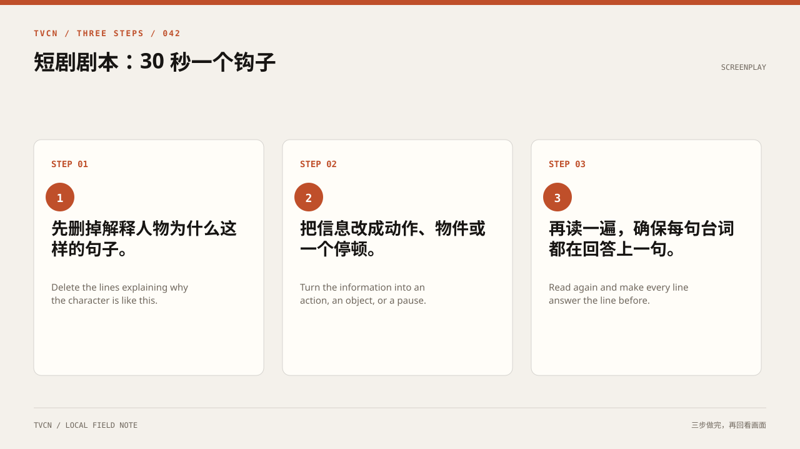

短剧剧本按“钩子—反转—留扣”写，每三十秒必须发生一件改变局面的事。

<!-- DIAGRAM_START -->
<h2>图解</h2>
<figure>
  
  <figcaption>把三步按顺序做完，再回看画面或文件。</figcaption>
</figure>
<!-- DIAGRAM_END -->
<h2>现场</h2>

每 30 秒列一个局面变化：身份暴露、钱被拿走、门被锁。把变化写成画面，不靠角色解释。

<h2>怎么做</h2>

短剧剧本按“钩子—反转—留扣”写，每三十秒必须发生一件改变局面的事。
<ol><li>每 30 秒列一个局面变化：身份暴露、钱被拿走、门被锁。</li><li>把变化写成画面，不靠角色解释。</li><li>结尾留一个未回答的问题，不要总结。下一条仍能接上。</li></ol>
<h2>别踩</h2>

别让角色解释反转；反转要发生在画面上。

<h2>验收</h2>
<ul><li>每 30 秒有一个局面变化，能用画面演出来。</li><li>反转不靠角色台词解释，观众能直接看到。</li><li>结尾停在一个未回答的问题上，没有总结。</li></ul>
