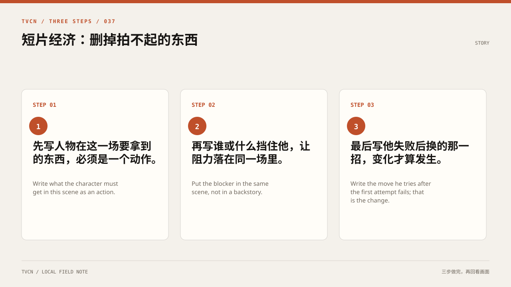

短片先删掉拍不起的场面，再把剩下的东西写得更具体。

<!-- DIAGRAM_START -->
<h2>图解</h2>
<figure>
  
  <figcaption>把三步按顺序做完，再回看画面或文件。</figcaption>
</figure>
<!-- DIAGRAM_END -->
<h2>现场</h2>

把剧本里最贵的三个场面划掉：人群、夜景、车辆。用一间房、两个人、一个道具重写，让冲突仍然成立。

<h2>怎么做</h2>

短片先删掉拍不起的场面，再把剩下的东西写得更具体。
<ol><li>把剧本里最贵的三个场面划掉：人群、夜景、车辆。</li><li>用一间房、两个人、一个道具重写。</li><li>确认冲突仍然成立，再补细节，不靠场面撑。</li></ol>
<h2>别踩</h2>

别用大场面遮剧本的空；拍不起的场面，观众也看不到人物。

<h2>验收</h2>
<ul><li>三个最贵场面已经删掉，剧本不靠它们成立。</li><li>重写版只用一个房间、两个人、一个道具。</li><li>冲突仍然清楚，删掉场面后人物反而更具体。</li></ul>
