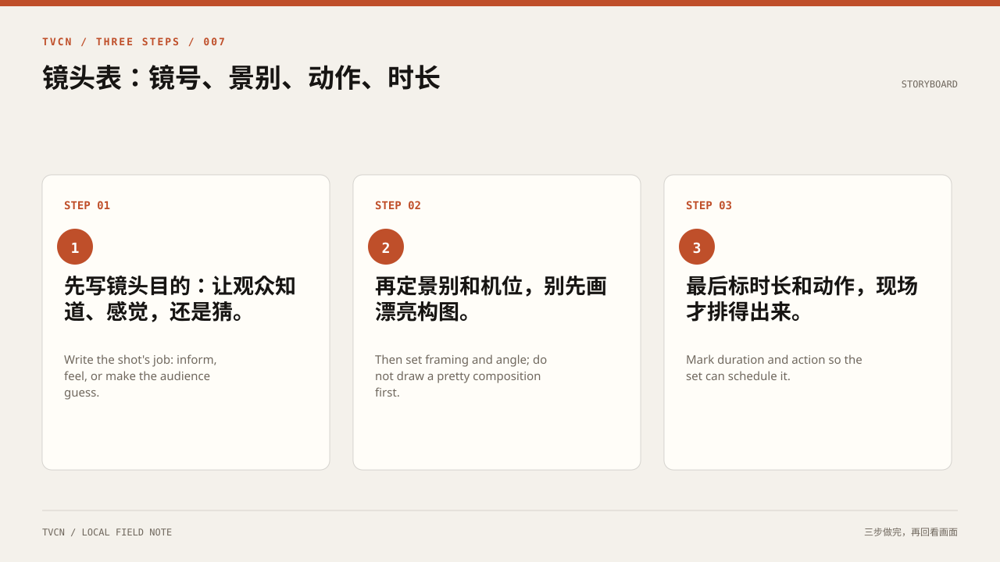

每行写：镜号、景别、机位、动作、台词、时长、道具、声音。少一项，现场就要停下来问。镜头表不是分镜的替代，而是分镜的可执行版。

<!-- DIAGRAM_START -->
<h2>图解</h2>
<figure>
  
  <figcaption>看“先填第 1、3、5 镜，每镜写一个动…”和“某镜超过 8 秒或没有动作，就删掉或…”两处，判断人物想要的東西能不能用一个动作说出来。</figcaption>
</figure>
<!-- DIAGRAM_END -->
<section><h2 id="section-1">一张镜头表要能在现场直接执行</h2>
按拍摄顺序而不是剪辑顺序排，把同一机位、同一光线的镜头放在一起，减少搬灯时间。
<h2 id="section-2">边界</h2>
镜头表可以改，但改完要同步给摄影、录音和场记。三个人拿着三个版本，比没有表更乱。
</section><section><h2 id="section-3">现场</h2>
先填第 1、3、5 镜，每镜写一个动词和一个秒数。开机前读一遍，某镜超过 8 秒或没有动作，就删掉或拆成两镜。
</section><section><h2 id="section-4">怎么做</h2><ol><li>先填第 1、3、5 镜，每镜写一个动词和一个秒数。</li><li>某镜超过 8 秒或没有动作，就删掉或拆成两镜。</li><li>开机前读一遍，让摄影和剪辑都能按顺序复述。</li></ol></section><section><h2 id="section-5">别踩</h2>
别画摄影机拍不到的东西；分镜不是插画。
</section><section><h2>判断</h2>
这一页的判断只看三条可观察的验收，不靠口号：
<ul><li><strong>1.</strong> 每镜都有镜号、景别、动作和秒数，四列不缺。</li><li><strong>2.</strong> 没有超过 8 秒还没有动作的镜头。</li><li><strong>3.</strong> 第三个人按表能复述先拍什么、后拍什么。</li></ul></section><section><h2>失败</h2>
下面任一条出现，先停，不要靠后期补：
<ul><li><strong>1.</strong> 只做到“每镜都有镜号、景别、动作和秒数，四列不缺”的形式，换一个机位或场景就重现不了。</li><li><strong>2.</strong> 把“没有超过 8 秒还没有动作的镜头”留到后期或口头解释，现场没有留下能复查的记录。</li><li><strong>3.</strong> 别画摄影机拍不到的东西；分镜不是插画。</li></ul></section><section><h2>延伸</h2>
<strong>10 分钟练习：</strong>写一页 30 秒的场景，只保留“先填第 1、3、5 镜，每镜写一个动…”和“某镜超过 8 秒或没有动作，就删掉或…”，删掉所有解释；请一个人读一遍，问他能不能复述人物想要什么。
</section>
<h2>验收</h2><ul><li>每镜都有镜号、景别、动作和秒数，四列不缺。</li><li>没有超过 8 秒还没有动作的镜头。</li><li>第三个人按表能复述先拍什么、后拍什么。</li></ul>

<!-- DEEP_DIVE_START -->
## 深读

<strong>约 5 分钟。</strong> 镜头表不是分镜的重复件。它管的是现场先拍什么、拍几条、什么时候能收工。

### 镜头表不是分镜，别画两遍

分镜回答画面长什么样，镜头表回答现场怎么执行。表里最少五列：镜号、景别、动作、机位、时长。每行只写一个主要动作，别把开门、坐下、说话塞进同一格。

先排保底镜头：全景交代空间，中景保表演，近景保情绪，插入保剪辑。每组至少两条，不然现场一慌就没有替代。

### 现场改表的三条规矩

第一条，先改顺序不改编号；第二条，补拍另起字母，不要插回原号；第三条，收工前用手机拍一张完整表，场记和剪辑各一份。纸会被雨、咖啡和手汗毁掉，照片不会。

如果一场戏超过十二个镜头，把它拆成上午和下午两块。人一累，最先漏的是插入和反应，不是主机位。

### 按机位排，不按剧情排

同一个机位能拍完的镜头放一起，省下的是搬灯、挪轨道和重新对焦的时间。剧情顺序留给剪辑，现场顺序服从机位。

每换一次机位，在表上画一条横线，写“换机位 / 预计 20 分钟”。现场最容易被低估的就是这二十分钟。

### 收工前三分钟

翻一遍表，确认每个动作都有全景、近景、插入；缺的那一条现在补，明天就补不了。把补拍写成字母编号，不要口头记。

用手机拍一张完整的表，再拍一张现场全景。场记、剪辑、导演各一份，第二天谁都不靠记忆。

### 出发前，镜头表要有这十样
<ul><li>每行只有一个主要动作</li><li>镜号、景别、动作、机位、时长五列齐全</li><li>每组都有全景、中景、近景、插入</li><li>按机位分组，不按剧情顺序</li><li>换机位处画横线并写预计耗时</li><li>补拍用字母编号，不插回原号</li><li>每个镜头写清需要什么道具</li><li>标出演员站位和视线方向</li><li>留一列给现场实际条数</li><li>收工前拍照发给场记和剪辑</li></ul>
镜头表不是给别人看的，是给明天的自己看的。明天的你不会记得今天为什么少拍一条。

<!-- DEEP_DIVE_END -->

<!-- SOURCES_START -->
## 参考与延伸阅读

- [S42] [Pixar in a Box：叙事课程](https://www.khanacademy.org/partner-content/pixar) — 2026-11-26 访问。用于核对「一张镜头表要能在现场直接执行」一节的术语/方法/规则（Pixar 叙事课程，不是项目报价）；不核对其中由本页经验得出的数字、型号与现场结论，也不替代测试。
- [S43] [BFI：国家档案馆](https://www.bfi.org.uk/bfi-national-archive) — 2026-11-26 访问。用于核对「现场」一节的术语/方法/规则（BFI 档案资料，不是发行规则）；不核对其中由本页经验得出的数字、型号与现场结论，也不替代测试。
<!-- SOURCES_END -->

