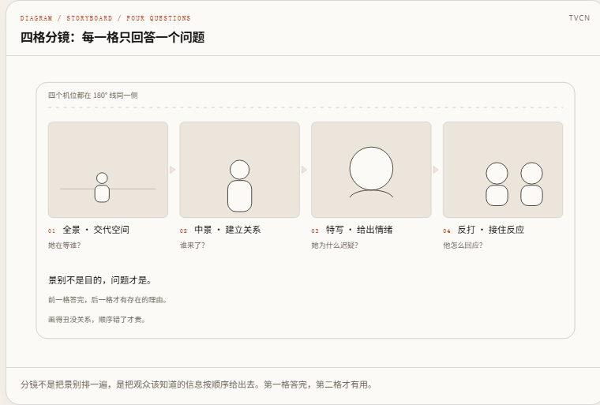

<!-- DIAGRAM_START -->
## 图解

<figure>
  
  <figcaption>分镜不是把景别排一遍，是把观众该知道的信息按顺序给出去。第一格答完，第二格才有用。</figcaption>
</figure>
<!-- DIAGRAM_END -->

分镜不是画得漂亮，是让现场的人知道下一秒拍什么。8 个镜头，先让动作成立。

## 先写动作，不写形容词

“孤独”“高级”“有电影感”都不是镜头。镜头要能回答：谁，在什么地方，做什么动作。写不出来，通常不是不会画，是动作还没想清楚。

每个镜头只放一个主要动作。一个镜头里同时开门、坐下、说话、哭，现场就会拍成四个半成品。

## 8 个镜头的顺序

用一个最小结构：交代空间 → 建立想要 → 出现阻碍 → 反应 → 决定 → 代价。8 个镜头里，至少要有 2 个交代镜头、2 个反应镜头、1 个特写。

不要从头到尾都用特写。观众需要知道人在哪、和谁在一起、空间有多大。全景不是“空镜”，它是信息。

## 分镜表的五个字段

镜号、景别、画面、动作、时长。五个字段就够。画面写“看到什么”，动作写“发生什么”，时长写“大概几秒”。

> 镜 03｜中景｜厨房，水壶在响｜她关火，去看手机｜4 秒

这张表给摄影师、演员、剪辑都能用。现场变化时，改表，不要改脑子里的版本。

## 3 条验收

- 8 个镜头，每个都能用“谁 + 做什么 + 在哪”说清。
- 至少 4 种景别，且有 2 个交代空间的镜头。
- 每个镜头只有一个主要动作。
