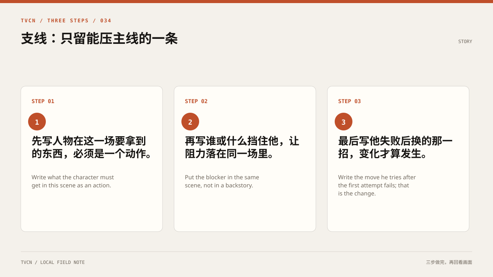

支线不是增加热闹，它要在某个时刻把主线逼得更紧。

<!-- DIAGRAM_START -->
<h2>图解</h2>
<figure>
  
  <figcaption>把三步按顺序做完，再回看画面或文件。</figcaption>
</figure>
<!-- DIAGRAM_END -->
<h2>现场</h2>

支线第一次出现就写它欠主线什么：一个人情、一条消息、一个把柄。每出现一次，主线就多一个不能忽略的压力。

<h2>怎么做</h2>

支线不是增加热闹，它要在某个时刻把主线逼得更紧。
<ol><li>支线第一次出现就写它欠主线什么：一个人情、一条消息、一个把柄。</li><li>每出现一次，主线就多一个不能忽略的压力。</li><li>如果删掉支线主线完全不变，就删掉它。</li></ol>
<h2>别踩</h2>

别为了热闹加支线；它不压主线，就是拖延。

<h2>验收</h2>
<ul><li>支线第一次出现就交代了它欠主线什么。</li><li>支线每出现一次，主线的选择都变难一点。</li><li>试着删掉支线，主线会缺一个压力，而不是完全不受影响。</li></ul>
