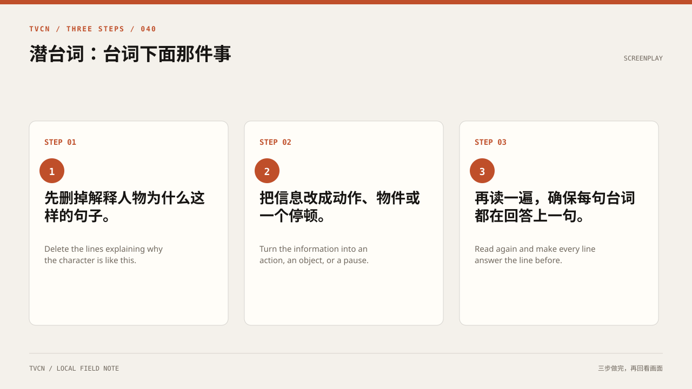

潜台词是人物嘴上说 A、心里要 B；导演的工作是让观众看见那个 B。

<!-- DIAGRAM_START -->
<h2>图解</h2>
<figure>
  
  <figcaption>把三步按顺序做完，再回看画面或文件。</figcaption>
</figure>
<!-- DIAGRAM_END -->
<h2>现场</h2>

给每句台词加一个隐藏动作：她嘴上说随便，手却把菜单合上。让演员演手，不演台词。

<h2>怎么做</h2>

潜台词是人物嘴上说 A、心里要 B；导演的工作是让观众看见那个 B。
<ol><li>给每句台词加一个隐藏动作：她嘴上说随便，手却把菜单合上。</li><li>让演员演手，不演台词。</li><li>回放确认台词和动作互相矛盾，观众能读出 B。</li></ol>
<h2>别踩</h2>

别让台词把潜台词说破；说破就没有潜台词了。

<h2>验收</h2>
<ul><li>每句关键台词都有一个相反或偏移的动作。</li><li>演员演的是手和身体，不是把潜台词念出来。</li><li>观众能说出角色嘴上要什么、实际要什么。</li></ul>
