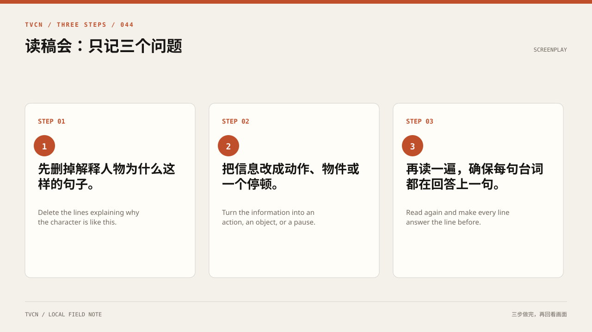

找两个不知道故事的人，从头读到尾，不打断。你只记三列：哪里听不懂、哪里不想看、哪里不相信。不要记“这里可以加个镜头”，那是下一轮的事。

<!-- DIAGRAM_START -->
<h2>图解</h2>
<figure>
  
  <figcaption>看“发三色便签：蓝=听不懂、红=不想看、…”和“每幕只讨论最多三张，不逐句改”两处，判断人物想要的東西能不能用一个动作说出来。</figcaption>
</figure>
<!-- DIAGRAM_END -->
<section><h2 id="section-1">读稿只记三类问题</h2>
读完先问“你觉得他想干什么”，再问“哪一句最假”。答案比赞美有用。
<h2 id="section-2">边界</h2>
读稿不是表演评审。不要因为一个人读得平就改台词；先判断是台词问题还是读的问题。
</section><section><h2 id="section-3">现场</h2>
读稿会发三色便签：听不懂用蓝、不想看用红、人物不像用黄。每幕只讨论最多三张，不逐句改。
</section><section><h2 id="section-4">怎么做</h2><ol><li>发三色便签：蓝=听不懂、红=不想看、黄=人物不像。</li><li>每幕只讨论最多三张，不逐句改。</li><li>会后只改被重复指出的那一处，其余记下一轮。</li></ol></section><section><h2 id="section-5">别踩</h2>
别把读稿会开成逐句改稿；一晚上改十页，第二天全推翻。
</section><section><h2>判断</h2>
现场只认三个信号：
<ul><li>人物的目标能用一个动作说出来</li><li>障碍在同一场里升级，而不是换一个</li><li>删掉一句解释对白，冲突仍然成立</li></ul></section><section><h2>失败</h2>
下面三种做法会让页面上的细节白做：
<ul><li>人物想要什么没写清，场面只剩情绪</li><li>障碍靠巧合解决，人物没有做决定</li><li>对白把画面已经说明的事再说一遍</li></ul></section><section><h2>延伸</h2>
<strong>10 分钟练习：</strong>写一页 30 秒的场景，只保留“发三色便签：蓝=听不懂、红=不想看、…”和“每幕只讨论最多三张，不逐句改”，删掉所有解释；请一个人读一遍，问他能不能复述人物想要什么。
</section>
<h2>验收</h2><ul><li>三类问题用三种颜色分开，讨论不混在一起。</li><li>每幕最多讨论三张便签，没有逐句改。</li><li>会后只改一个被重复指出的问题，其余有记录。</li></ul>

<!-- SOURCES_START -->
## 经验说明

经验说明：本页来自 7 次剧本围读与拍摄前排练，条件为3–8 页场景、单一主视角；页面讨论的具体对象是「读稿会：只记三个问题」；不含外部实验室测试，条件变化时结论可能失效。
<!-- SOURCES_END -->

