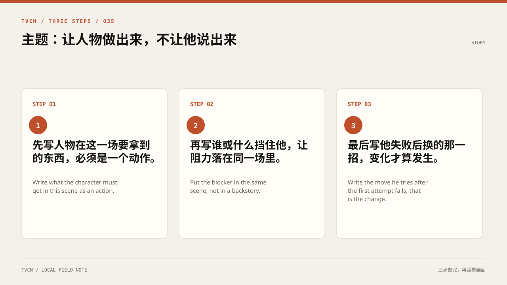

主题不要让人物讲出来，让他在压力下做一个能暴露价值观的选择。

<!-- DIAGRAM_START -->
<h2>图解</h2>
<figure>
  
  <figcaption>把三步按顺序做完，再回看画面或文件。</figcaption>
</figure>
<!-- DIAGRAM_END -->
<h2>现场</h2>

先写一句你不打算让角色说出的主题，再设计一个选择：他为了 A 放弃 B，镜头只拍他伸手和停住。

<h2>怎么做</h2>

主题不要让人物讲出来，让他在压力下做一个能暴露价值观的选择。
<ol><li>先写一句你不打算让角色说出的主题。</li><li>设计一个选择：他为了 A 放弃 B。</li><li>镜头只拍他伸手和停住，让观众自己读出主题。</li></ol>
<h2>别踩</h2>

别让主题靠台词总结；让选择本身暴露立场。

<h2>验收</h2>
<ul><li>成片里没有人说出那句主题，主题靠选择成立。</li><li>选择有明确的 A 和 B，观众知道放弃了什么。</li><li>最后一个动作是伸手或停住，不是解释性台词。</li></ul>

<!-- DEEP_DIVE_START -->
## 深读

<strong>约 6 分钟。</strong> 主题不是人物说出来的道理，是他在压力下重复做出的选择。

### 主题是一个动词

不要写“家庭重要”，写“他每次都在饭点前赶回家”；动作重复，主题才出现。

主题要能被摄像机拍到：赶车、做饭、让座、关门；不要只写“他明白了”。

如果主题只能靠旁白说，观众记住的是句子，不是人。

### 让反主题也有道理

对手要代表另一种活法，不能只是坏人；两种选择都能理解，观众才会想。

反主题人物要有自己的代价和收益：他选了事业，失去了什么；他选了自由，又付了什么。

不要用台词替观众判对错；让两种选择在同一个场景里碰撞，观众自己会选边。

### 结尾用动作回答

最后不要演讲；让他在同一情境下做出不同选择，主题自己落地。

开头他赶回家，结尾他选择留下加班；同一个饭点，不同的动作，观众知道主题变了。

不要解释“这就是成长”；让下一个动作承担结论。

### 反主题也要有胜利

给反主题一次真实的赢，不要让他只做错事；他赢了，主角的选择才有压力。

反主题的胜利要付出代价，但代价不能立刻抵消胜利；观众要先看见好处，才会理解诱惑。

最后不要用配乐告诉观众该感动；让动作和沉默自己说话。音乐一推，主题就变成宣传。

### 五分钟练习：主题三证一反

写一句主题，再写三个能证明它的动作、一个反证；反证站不住，主题就是口号。

把三个动作排进三场戏，不要放在同一场；重复要跨时间，观众才信。

### 主题检查，十项
<ul><li>主题能写成一个动词</li><li>主题能被镜头拍到</li><li>三个动作跨三场戏</li><li>反主题人物有道理</li><li>反主题也有代价</li><li>不用台词判对错</li><li>开头和结尾同一情境</li><li>结尾用动作回答</li><li>不解释成长</li><li>反证站得住</li></ul>
主题不是观众听到的话，是观众看到一个人反复做的事。

<!-- DEEP_DIVE_END -->
