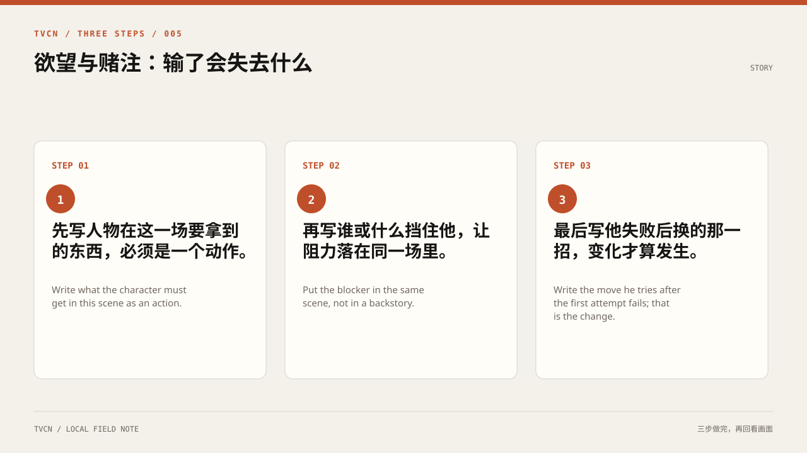

“想要被认可”太抽象，换成“想在周五前拿到那笔签字”。失去也要具体：失去工作、失去住处、失去一个人的信任。抽象欲望无法驱动动作，具体损失才能。

<!-- DIAGRAM_START -->
<h2>图解</h2>
<figure>
  
  <figcaption>看“写他这一场想要的具体东西：一把钥匙、…”和“写失去它的具体代价：今晚进不了门、丢…”两处，判断人物想要的東西能不能用一个动作说出来。</figcaption>
</figure>
<!-- DIAGRAM_END -->
<section><h2 id="section-1">想要要具体，失去要可见</h2>
写三列：他想要什么、如果失败失去什么、他愿意付出什么。三列必须在同一场戏里能同时出现。
<h2 id="section-2">边界</h2>
赌注不是越大越好。一个普通人失去一份工作，比一个超级英雄失去地球更让观众坐得住；规模要匹配人物。
</section><section><h2 id="section-3">现场</h2>
写一场戏前先填两格：他想要的具体东西，一把钥匙或一个签名；失去它的具体代价，今晚进不了门或丢工作。两格都写名词和动作，不写尊严、安全感。
</section><section><h2 id="section-4">怎么做</h2>
先写具体物件，再写具体代价。
<ol><li>写他这一场想要的具体东西：一把钥匙、一个签名、一句话。</li><li>写失去它的具体代价：今晚进不了门、丢工作、错过一个人。</li><li>两格都写名词和动作，不写尊严、安全感这类抽象词。</li></ol></section><section><h2 id="section-5">别踩</h2>
别用人物小传代替一场戏；观众看不到过去，只能看到现在。
</section><section><h2>判断</h2>
现场只认三个信号：
<ul><li>人物的目标能用一个动作说出来</li><li>障碍在同一场里升级，而不是换一个</li><li>删掉一句解释对白，冲突仍然成立</li></ul></section><section><h2>失败</h2>
下面三种做法会让页面上的细节白做：
<ul><li>人物想要什么没写清，场面只剩情绪</li><li>障碍靠巧合解决，人物没有做决定</li><li>对白把画面已经说明的事再说一遍</li></ul></section><section><h2>延伸</h2>
<strong>10 分钟练习：</strong>写一页 30 秒的场景，只保留“写他这一场想要的具体东西：一把钥匙、…”和“写失去它的具体代价：今晚进不了门、丢…”，删掉所有解释；请一个人读一遍，问他能不能复述人物想要什么。
</section>
<h2>验收</h2><ul><li>两格里都是可拍的名词和动作，没有“尊严”“安全感”这类抽象词。</li><li>想要的东西和失去的代价在同一场里发生，不靠旁白补充。</li><li>换一个人来读，也能说出他具体怕失去什么。</li></ul>

<!-- DEEP_DIVE_START -->
## 深读

<strong>约 6 分钟。</strong> 欲望和赌注不是人物简介，是观众要知道他得不到会失去什么。

### 欲望要具体

不要“想成功”，写“想让女儿在开学前住进有窗的房子”；具体目标才能拍成动作。

欲望要能被摄像机拍到：搬家、签字、交钥匙，不是“变得更好”。

### 赌注要可见

失去什么：钱、关系、身份、时间；让观众在第一个场景就看到代价，不要到最后才说。

赌注不一定是生死；一个母亲错过家长会，也可能是她这一年最重的事。

### 压力升级

同一堵墙越收越紧：第一次迟到、第二次丢工作、第三次失去抚养权；每次加码都要改变人物的选择。

升级不是重复同一种倒霉；每次要让主角换一个方法，代价更高。

### 把赌注放到动作里

不要让人物说“我不能失去你”，让他把最后一笔钱转出去，或者把钥匙交出去；动作让赌注可见。

每个场景结束问一次：他刚刚失去了什么，或者差点失去什么？没有答案，这场戏可能只是信息。

赌注要能被另一个角色看见；只有观众知道，压力还不够。让对手也知道这个代价，才会形成真正的对抗；对手不知道，冲突就软。

结尾不要解释赌注，让选择本身说话。如果观众说不清他怕失去什么，回去删设定，补动作。

### 一句话检查

让一个没读过故事的朋友听你说一句：“他想要____，如果得不到，就会失去____。”两空都具体，故事才成立。

如果朋友追问“为什么不能换一个目标”，说明赌注还不够疼；回去把代价加到他换不起。

### 故事成立前，十项检查
<ul><li>主角想要的东西能拍出来</li><li>目标有明确截止时间</li><li>第一个场景就看到代价</li><li>赌注具体到钱、关系或身份</li><li>对手有相反的目标</li><li>每次升级都改变选择</li><li>主角不能靠运气过关</li><li>失败一次比一次贵</li><li>结尾停在选择之后</li><li>观众能说出他怕失去什么</li></ul>
观众不是为设定紧张，是为一个人快要失去的东西紧张。

<!-- DEEP_DIVE_END -->
