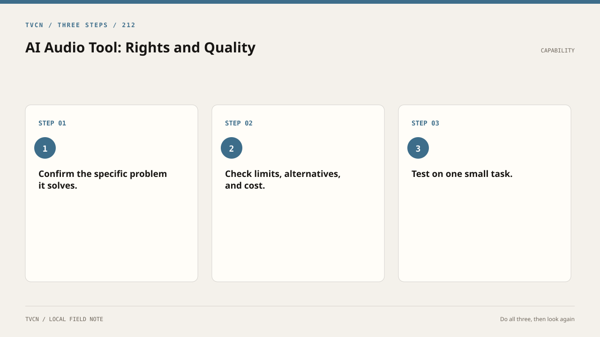

Check rights and audio quality before features; a cloned voice's license matters more than timbre.

<!-- DIAGRAM_START -->
<h2>Diagram</h2>
<figure>
  
  <figcaption>Do the three steps in order, then look again at the image or file.</figcaption>
</figure>
<!-- DIAGRAM_END -->
<h2>On set</h2>

Have the tool read thirty seconds of dialogue and listen for sibilance, phrasing, and endings. Then check commercial rights and clone scope.

<h2>Do this</h2>

An AI audio tool is judged by license and quality before features; clone scope matters more than timbre.
<ol><li>Have it read a thirty-second line.</li><li>Listen for sibilance, pauses, and tails.</li><li>Then check commercial license and clone scope.</li></ol>
<h2>Avoid</h2>

Do not judge timbre alone; a personal-use license still blocks commercial work.

<h2>Check</h2>
<ul><li>Sibilance, pauses, and tails are assessed on a thirty-second line.</li><li>Commercial license and clone scope have written terms.</li><li>Output clears the current project without extra licensing.</li></ul>
