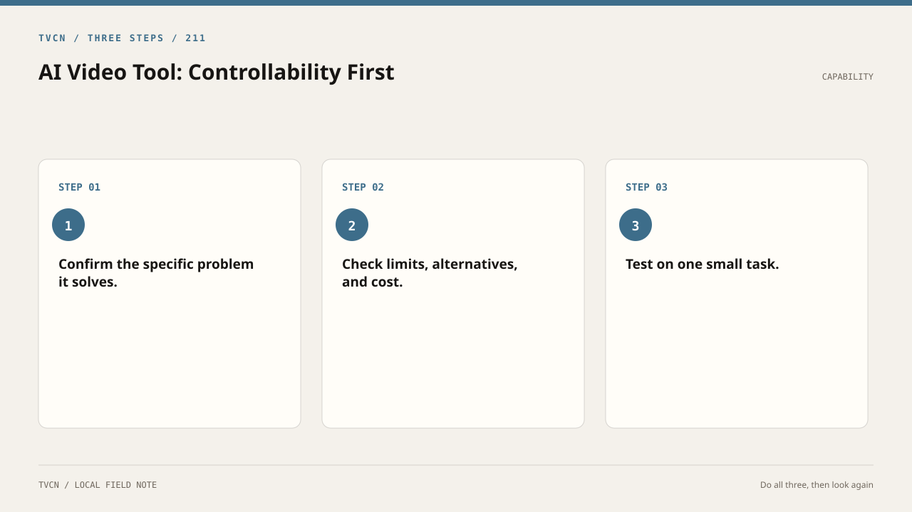

Check controllability: can it lock character, camera, duration? Demo reels lie.

<!-- DIAGRAM_START -->
<h2>Diagram</h2>
<figure>
  
  <figcaption>Do the three steps in order, then look again at the image or file.</figcaption>
</figure>
<!-- DIAGRAM_END -->
<h2>On set</h2>

Test one prompt for three things: character consistency, camera control, and usable duration. Pay only after all three pass.

<h2>Do this</h2>

An AI video tool is judged by control: can it lock character, camera, and duration; demo reels lie.
<ol><li>Use one prompt to test character consistency, camera control, and duration.</li><li>Pay only after all three pass.</li><li>Save the failure cases too.</li></ol>
<h2>Avoid</h2>

Do not be fooled by demo reels; they show success, not character drift.

<h2>Check</h2>
<ul><li>The same prompt keeps the character consistent across three shots.</li><li>Camera motion and duration respond to specific controls.</li><li>Failure cases are saved and the boundary is known.</li></ul>
