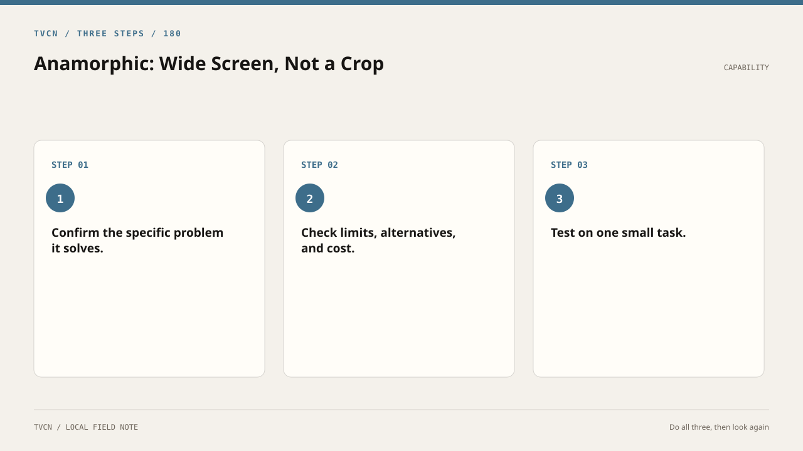

For wide, light, fast autofocus or clean images, do not use an anamorphic. It is a style choice with a cost.

<!-- DIAGRAM_START -->
<h2>Diagram</h2>
<figure>
  
  <figcaption>Watch “Shoot neon at night and look for oval” and “Shoot a face and check whether horizontal stretch”; judge whether the spec maps to one concrete shooting problem.</figcaption>
</figure>
<!-- DIAGRAM_END -->
<section><h2 id="section-1">What to compare first</h2><ul><li><strong>Squeeze ratio:</strong> confirm 1.33x/1.5x/2x compatibility with sensor and desqueeze; a mismatch distorts.</li><li><strong>Flare and distortion:</strong> flare is not the only selling point; edge distortion and close focus affect composition.</li><li><strong>Focus and weight:</strong> manual focus, long throw and heavy front; a gimbal needs rebalancing.</li></ul><h2 id="section-2">When not to use it</h2></section><section><h2 id="section-3">On set</h2>
Shoot neon at night and look for oval bokeh and the horizontal blue flare. Then shoot a face and judge the horizontal stretch.
</section><section><h2 id="section-4">Do this</h2>
Anamorphic does not crop the top and bottom; it squeezes horizontally and expands back, producing oval bokeh and unique distortion.
<ol><li>Shoot neon at night and look for oval bokeh and a horizontal blue line.</li><li>Shoot a face and check whether horizontal stretch is acceptable.</li><li>Keep anamorphic and cropping as separate ideas.</li></ol></section><section><h2 id="section-5">Avoid</h2>
Do not call cropping anamorphic; without oval bokeh and horizontal squeeze, it is only widescreen.
</section>
<h2>Check</h2><ul><li>Neon night footage shows oval bokeh or a horizontal blue line.</li><li>A face sample reveals horizontal stretch and whether it is acceptable.</li><li>Anamorphic and cropping are clearly distinguished.</li></ul>

> Intent split: this page covers the practical details of “Anamorphic: Wide Screen, Not a Crop”; start with <a href="https://tools.tvcn.org/article/buy-lens-first/">Buy the Lens First: Focal Length, Aperture, Breathing</a> for the cluster-level judgement, then return here.

<!-- INTENT_SCOPE -->

<!-- SOURCES_START -->
## Experience note

Experience note: this page draws on 7 gear trial and playback reviews under the listed model and firmware, once indoors and once outdoors; it discusses “Anamorphic: Wide Screen, Not a Crop”; no external laboratory test was run, and the conclusion may not transfer when conditions change.
<!-- SOURCES_END -->

