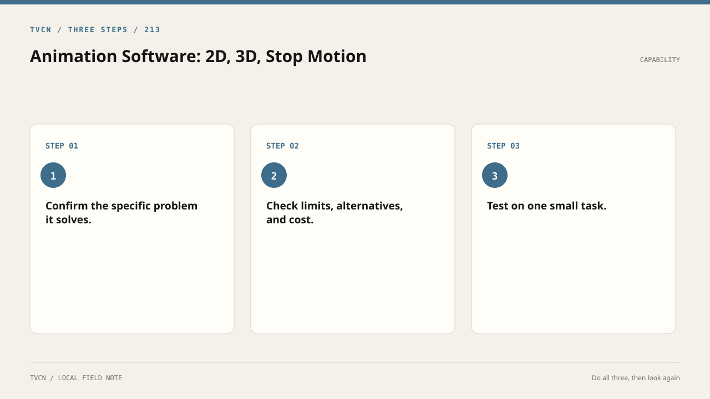

For a small project with a fluent team, switching costs more than it returns. Fix naming, versions and handoff in the current pipeline first.

<!-- DIAGRAM_START -->
<h2>Diagram</h2>
<figure>
  
  <figcaption>Watch “Take the same five-second action and test it” and “See which pipeline reaches a watchable result fastest.”; judge whether the spec maps to one concrete shooting problem.</figcaption>
</figure>
<!-- DIAGRAM_END -->
<section><h2 id="section-1">Choose by pipeline, not feature list</h2><ul><li><strong>2D:</strong> for frame-by-frame, rigging and compositing, choose a tool that handles layers and camera; a brush feature list misses compositing.</li><li><strong>3D:</strong> modeling, materials, lighting, rendering and caching; confirm asset handoff and renderer, not only modeling.</li><li><strong>Stop motion:</strong> frame import, onion skin and alignment; a compositor cannot replace capture control.</li></ul><h2 id="section-2">When not to switch</h2></section><section><h2 id="section-3">On set</h2>
Animate the same five-second action in 2D, 3D, and stop motion. See which pipeline gives a watchable result fastest.
</section><section><h2 id="section-4">Do this</h2>
Animation software is chosen by pipeline: 2D for drawing and comp, 3D for rigging and render, stop motion for shoot control; no one app covers all.
<ol><li>Take the same five-second action and test it in 2D, 3D, and stop motion.</li><li>See which pipeline reaches a watchable result fastest.</li><li>Choose by pipeline bottleneck, not feature list.</li></ol></section><section><h2 id="section-5">Avoid</h2>
Do not hunt for one all-in-one app; 2D, 3D, and stop motion are different pipelines.
</section>
<h2>Check</h2><ul><li>The same five-second action is tested in three pipelines.</li><li>The fastest watchable pipeline is identified.</li><li>The choice follows the bottleneck, not feature count.</li></ul>
