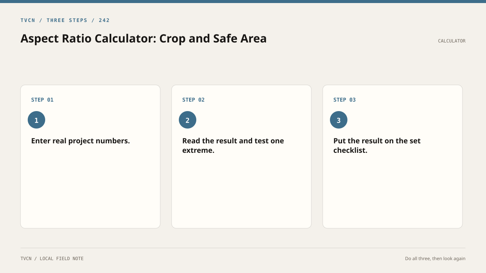

Calculate effective pixels after crop, then safe area; vertical is not a horizontal crop.

<!-- DIAGRAM_START -->
<h2>Diagram</h2>
<figure>
  
  <figcaption>Do the three steps in order, then look again at the image or file.</figcaption>
</figure>
<!-- DIAGRAM_END -->
<h2>On set</h2>

4K 16:9 cropped to 9:16 leaves about 1215×2160. Confirm the pixels are enough and redraw safe areas per platform.

<h2>Do this</h2>

An aspect-ratio calculator first computes effective pixels after crop, then the safe area; vertical is not just cropping the sides.
<ol><li>4K 16:9 cropped to 9:16 leaves about 1215×2160.</li><li>Confirm the pixel count is enough.</li><li>Redraw the safe area for the platform.</li></ol>
<h2>Avoid</h2>

Do not crop landscape into vertical blindly; effective pixels halve and close-ups soften.

<h2>Check</h2>
<ul><li>Cropped effective pixels are numeric, about 1215×2160.</li><li>Pixels meet delivery needs without upscaling.</li><li>The safe area is redrawn for vertical platforms, not reused from landscape.</li></ul>
