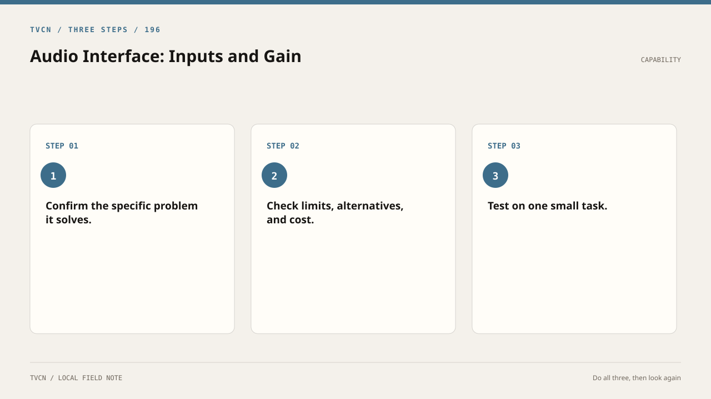

If you only need one lav into a camera, an interface is an extra link; solve mic distance and gain first. Do not replace recording basics with more boxes.

<!-- DIAGRAM_START -->
<h2>Diagram</h2>
<figure>
  
  <figcaption>Watch “Connect a dynamic mic and set gain to” and “Record thirty seconds of silence and listen to”; judge whether the spec maps to one concrete shooting problem.</figcaption>
</figure>
<!-- DIAGRAM_END -->
<section><h2 id="section-1">What to compare first</h2><ul><li><strong>Inputs and gain:</strong> confirm the preamp has enough gain for your mic and the noise floor at maximum is acceptable.</li><li><strong>Channels and monitoring:</strong> how many independent inputs, direct monitoring and headphone output; live work also needs a return.</li><li><strong>Connection and power:</strong> is USB bus power stable, or does it need a supply? Will a long cable add noise?</li></ul><h2 id="section-2">When not to use it</h2></section><section><h2 id="section-3">On set</h2>
Connect a dynamic mic at 70 percent gain and record thirty seconds of silence. Listen to the noise floor and check the maximum gain.
</section><section><h2 id="section-4">Do this</h2>
An audio interface is judged by input count, gain range, and noise floor; a pricey box with too little gain cannot record quiet speech.
<ol><li>Connect a dynamic mic and set gain to 70 percent.</li><li>Record thirty seconds of silence and listen to the noise floor.</li><li>Check whether maximum gain is enough for quiet dialogue.</li></ol></section><section><h2 id="section-5">Avoid</h2>
Do not count inputs only; without gain, quiet dialogue is all noise floor.
</section>
<h2>Check</h2><ul><li>A dynamic mic records thirty seconds of silence at 70 percent gain.</li><li>The noise floor is described, not just “fine.”</li><li>Maximum gain captures quiet dialogue with acceptable noise.</li></ul>

<!-- SOURCES_START -->
## Sources

- [S31] ARRI Cine Systems; see the original link and use note in SOURCES.md.
- [S23] SMPTE 标准入口; see the original link and use note in SOURCES.md.

Full links and use notes: [`SOURCES.md`](../../about/).
<!-- SOURCES_END -->
