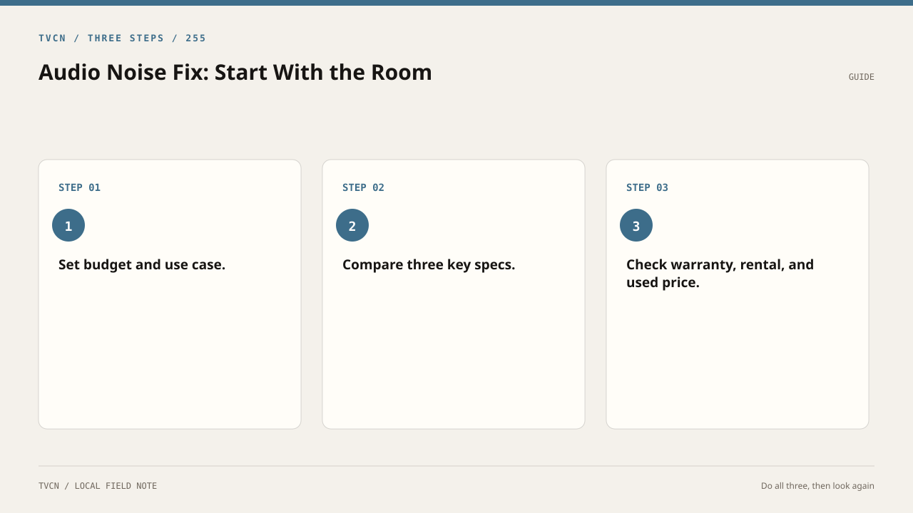

Start with the room: air conditioning, lights, outlet, cable; blame the mic last.

<!-- DIAGRAM_START -->
<h2>Diagram</h2>
<figure>
  
  <figcaption>Do the three steps in order, then look again at the image or file.</figcaption>
</figure>
<!-- DIAGRAM_END -->
<h2>On set</h2>

Turn off air conditioning, lights, and fans, then change outlets and cables. Record a comparison on a phone to find the source.

<h2>Do this</h2>

Noise starts in the room: turn off AC, change outlets and cables, blame the mic last.
<ol><li>Turn off AC, fridge, and lights; record thirty seconds of silence.</li><li>Change outlets and cables, and put gain on the recorder.</li><li>Move the subject closer and record room tone for a bed.</li></ol>
<h2>Avoid</h2>

Do not buy a new mic first; the noise may be power or the room.

<h2>Check</h2>
<ul><li>Thirty seconds of silence was recorded with AC, fridge, and lights off.</li><li>Outlets and cables were changed and gain sits on the recorder.</li><li>The subject is close to the mic and room tone exists.</li></ul>
