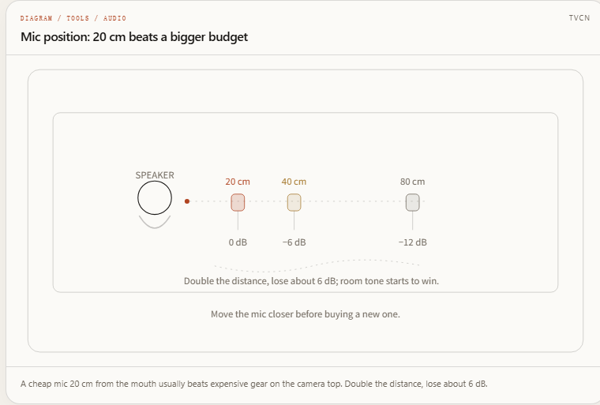

<!-- DIAGRAM_START -->
## Diagram

<figure>
  
  <figcaption>A cheap mic 20 cm from the mouth usually beats expensive gear on the camera top. Double the distance, lose about 6 dB.</figcaption>
</figure>
<!-- DIAGRAM_END -->

A cheap mic twenty centimeters from the mouth usually beats an expensive rig mounted on the camera.

## Distance

The closer the mic, the stronger the direct voice and the weaker the room. A lavalier sits fifteen to twenty centimeters from the mouth; a boom mic stays forty to sixty centimeters outside the frame. Do not use the on-camera mic for dialogue.

The on-camera mic is far away; it records the room, not the person. It is fine for ambience, not for the main voice.

## Direction

Point the shotgun at the mouth, not the chest. Keep the lav away from collar friction and hair; use a wind cover, not tape on skin.

Monitor with headphones for thirty seconds before recording. A level meter is not enough; listen for hum, air conditioning, refrigerators, and distant traffic.

## Backup

Record important dialogue twice: lav plus boom, or recorder plus camera. 32-bit float can rescue some clipping, but it cannot rescue sound that was never captured.

Record thirty seconds of clean ambience at every location and note it on the slate. What post lacks most is not gear; it is thirty seconds of silence nobody recorded.

## Three checks

- Main dialogue is not from the on-camera mic.
- Mic distance and direction have a reason.
- Important scenes have a second recording or thirty seconds of ambience.

<!-- DEEP_DIVE_START -->
## Deep dive

<strong>About 7 minutes.</strong> Mic position matters more than mic price. Wrong position, and an expensive mic records the room.

### Lav placement

Place the lav on the chest centerline, about a palm below the chin. Too high pops; too low picks up clothing. Do not put it outside the collar; wind will hit it.

Avoid scarves, zippers, necklaces. Tape it inside with a little slack. Before rolling, have the person turn, raise arms, sit; listen for friction.

### Boom distance

Boom just above and in front of the head, outside frame, forty to sixty centimeters from the mouth. Closer is drier; farther is roomier. Do not place it directly overhead; it picks up ceiling reflection.

In a two-person dialogue, follow the speaker. Do not park it in the middle to avoid moving; the middle often records both badly.

### Record a thirty-second test

Record thirty seconds before rolling: three lines, a turn, a sit, two steps. Play back for friction, plosives, room tone, air conditioning. Fix on set, not in post.

Record ten seconds of room tone. Keep dialogue and room tone separate so edits can bridge cleanly.

### Five-minute drill: three positions

Record the same line three ways: lav on chest, lav outside collar, boom in front of the head. Play each and write dry, muffled, friction, or roomy.

Pick the driest and note the position. Start there next time, then adjust.

### When audio is clear

With headphones: no plosives, no clothing friction, no air conditioner, no sudden peak across three lines; room tone present but steady; voice does not drop when the person turns. Four pass.

If one fails, do not rescue it with noise reduction. Change the position and record again.

### Listen to the turn again

Have the person turn left and right while you listen on headphones: any friction, any sudden level drop? If the voice drops on a turn, the mic position or clothing is blocking it. Two turns on set save ten fixes in post.

### Ten audio-position checks
<ul><li>Lav on chest centerline</li><li>About a palm below the chin</li><li>Not outside the collar</li><li>Avoid scarves, zippers, necklaces</li><li>Tape with slack</li><li>Boom above and in front, outside frame</li><li>Forty to sixty centimeters from mouth</li><li>Boom follows the speaker</li><li>Thirty-second test before rolling</li><li>Ten seconds of room tone</li></ul>
The first audio budget is not a better mic. It is putting the mic closer to the mouth.

<!-- DEEP_DIVE_END -->
