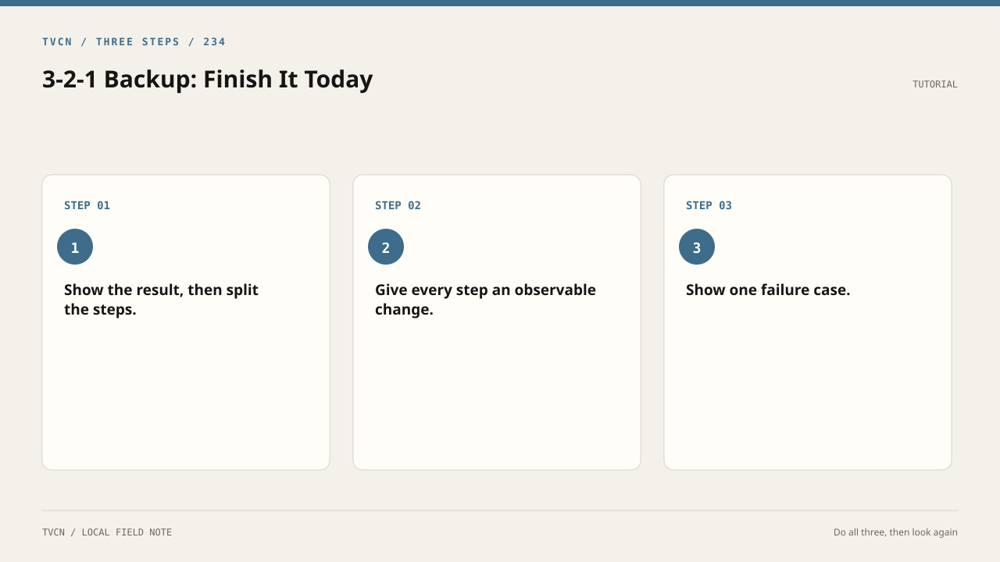

3-2-1 is not “upload to cloud and done.” On a shoot day make at least three copies: card/camera, on-set drive, and another offline drive or cloud. One copy sits in a different building.

<!-- DIAGRAM_START -->
<h2>Diagram</h2>
<figure>
  
  <figcaption>Watch “Copy the card to SSD the same day.” and “Copy to a second drive.”; judge whether the spec maps to one concrete shooting problem.</figcaption>
</figure>
<!-- DIAGRAM_END -->
<section><h2 id="section-1">Three copies, two media, one off-site, same day</h2>
Every copy must read: randomly play one file and check name and duration. “Copy completed” is not a backup.
<h2 id="section-2">Limits</h2>
RAID is not backup, and a sync folder is not backup. A deletion syncs; ransomware encrypts the whole set. Keep at least one offline, read-only or versioned copy.
</section><section><h2 id="section-3">On set</h2>
Copy the card to an SSD, then to another drive, then to NAS or cloud. Format the card only after three copies exist.
</section><section><h2 id="section-4">Do this</h2>
3-2-1 backup finishes the same day: three copies, two media types, one offsite; wait until tomorrow and the media may be gone.
<ol><li>Copy the card to SSD the same day.</li><li>Copy to a second drive.</li><li>Upload to NAS or cloud, and format the card only after three copies.</li></ol></section><section><h2 id="section-5">Avoid</h2>
Do not plan to back up tomorrow; if the card is lost, three copies never happen.
</section><figure class="article-audio"><audio controls preload="none" src="../../../assets/audio/en/tool-backup-3-2-1.en.mp3"></audio><figcaption>20-second audio demo: one check point and the most common failure. Transcript and steps are in the article.</figcaption></figure><section><h2>Judge</h2>
Three signals are observable on set:
<ul><li>every spec maps to one concrete shooting problem</li><li>weight, power and connections hold on a real rig</li><li>a 60-second test leaves one comparable number</li></ul></section><section><h2>Failures</h2>
These three moves erase the detail you just built:
<ul><li>specs without connections, power or weight</li><li>batteries, storage or body do not match after purchase</li><li>no 60-second test, so the problem arrives on the shoot</li></ul></section><section><h2>Extend</h2>
<strong>10-minute exercise:</strong> Run a 60-second test with the gear you already own, measuring only “Copy the card to SSD the same day.”. Record two numbers: what you need and what the gear actually gives.
</section>
<h2>Check</h2><ul><li>Three copies complete the same day with matching file counts.</li><li>Two media types are used, one offsite or cloud.</li><li>The card is formatted only after all three are confirmed.</li></ul>

<!-- DEEP_DIVE_START -->
## Deep dive

<strong>About 5 minutes.</strong> Backup is not dragging files to another drive. It is making sure tomorrow can still open and export them.

### The same-day backup routine

Offload, verify, rename, make two media copies, and keep one away from the machine. Name files date_project_camera_card; never “final.” Open three random files after the copy instead of trusting the progress bar.

Skip it today and tomorrow starts from zero. Confirm both copies before formatting the card.

### Run a restore drill

Once a month, pick a random project and open it from backup: find the original media and export one minute. Record how long it took and what was missing. An untested backup is only reassurance.

Put the restore steps on one page at the root of the project drive. In six months you will forget the password, the software version, and where the adapter went.

### Cards, drives, and the cloud

A card is transport, not storage; the working drive is the copy being edited; backup drives and an offsite copy are insurance. Each has a job and none replaces another.

Cloud is for small files and final delivery, not hundreds of gigabytes of raw footage a day. Upload time is also a cost.

### Naming and folders

A project root holds four things: media, projects, exports, documents. Media by date_camera, projects by version, exports by platform. Do not leave everything on the desktop.

Ban “final,” “final2,” and “really final.” Use date and version so three months later you still know what shipped.

### Ten steps for every offload
<ul><li>Confirm the card plays back before copying</li><li>Copy to the first working drive</li><li>Verify file count and decode with a checksum tool</li><li>Rename date_project_camera_card</li><li>Copy to a second backup drive</li><li>Move one copy off this machine</li><li>Open three random files and play them</li><li>Confirm both copies before formatting the card</li><li>Put restore steps at the project root</li><li>Run one restore drill per month</li></ul>
Backup is not dragging files across; it is making sure tomorrow can still open, export, and deliver. Before formatting the card, open both copies once; open, play, and export is what makes a backup real.

<!-- DEEP_DIVE_END -->

> Intent split: this page covers the practical details of “3-2-1 Backup: Finish It Today”; start with <a href="https://tools.tvcn.org/article/buy-storage/">Buying Project Storage: Speed, Capacity, and Backup</a> for the cluster-level judgement, then return here.

<!-- INTENT_SCOPE -->

<!-- SOURCES_START -->
## References and further reading

- [S23] [SMPTE Standards](https://www.smpte.org/standards) — Accessed 2026-11-26. Used to check the terminology and public context in the opening paragraph (“Do 3-2-1 today: three copies, two media, one offsite; tomorr”) against Entry point for timecode, color, cinema and signal-chain standards; not a substitute for an on-set test.
- [S31] [ARRI Cine Systems](https://www.arri.com/en/cine-systems) — Accessed 2026-11-26. Used to check the terminology and public context in the opening paragraph (“Do 3-2-1 today: three copies, two media, one offsite; tomorr”) against Technical documentation for cameras, lenses and lighting; not a substitute for an on-set test.
- [S29] [YouTube Upload Specs](https://support.google.com/youtube/answer/1722171) — Accessed 2026-11-26. Used to check the terminology and public context in the opening paragraph (“Do 3-2-1 today: three copies, two media, one offsite; tomorr”) against Recommended resolution, bitrate, frame rate and audio codec; not a substitute for an on-set test.
- [S30] [DaVinci Resolve](https://www.blackmagicdesign.com/products/davinciresolve) — Accessed 2026-11-26. Used to check the terminology and public context in the opening paragraph (“Do 3-2-1 today: three copies, two media, one offsite; tomorr”) against Official entry for editing, grading, Fusion and delivery; not a substitute for an on-set test.
- [S70] [FFmpeg: Documentation](https://ffmpeg.org/documentation.html) — Accessed 2026-11-26. Used to check the terminology and public context in the opening paragraph (“Do 3-2-1 today: three copies, two media, one offsite; tomorr”) against Codec, muxing and filter documentation; not a substitute for an on-set test.
<!-- SOURCES_END -->

