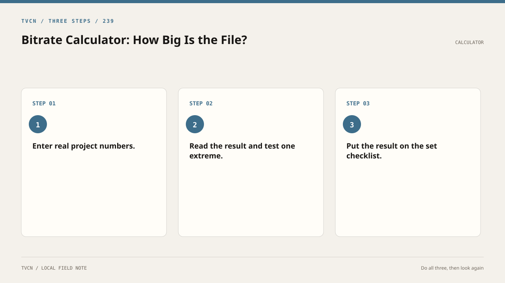

Calculate file size from minutes and Mbps; know if the drive fits before delivery.

<!-- DIAGRAM_START -->
<h2>Diagram</h2>
<figure>
  
  <figcaption>Do the three steps in order, then look again at the image or file.</figcaption>
</figure>
<!-- DIAGRAM_END -->
<h2>On set</h2>

Enter minutes and Mbps to get GB. Add 20 percent headroom, then check the card and drive.

<h2>Do this</h2>

A bitrate calculator converts minutes and Mbps into file size; know whether the drive fits before delivery.
<ol><li>Enter minutes and Mbps.</li><li>Calculate GB and add 20 percent headroom.</li><li>Compare with free space on card and drive.</li></ol>
<h2>Avoid</h2>

Do not read Mbps as MB; the factor of eight undercounts the drive.

<h2>Check</h2>
<ul><li>Minutes and Mbps convert correctly to GB.</li><li>The result includes 20 percent headroom.</li><li>Free space on card and drive is checked before delivery.</li></ul>
