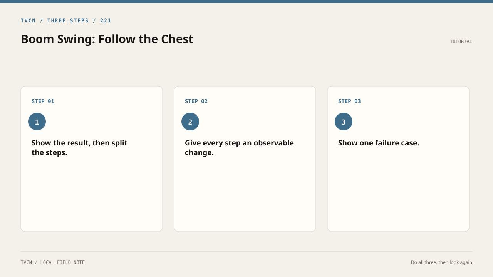

The operator must know where the actor goes next: watch rehearsal, listen for cues, track feet. Keep the tip 40–60 cm above and ahead, out of the shadow; move around outside frame, never across the head.

<!-- DIAGRAM_START -->
<h2>Diagram</h2>
<figure>
  
  <figcaption>Watch “Track the boom head to the chest.” and “Keep forty to sixty centimeters away.”; judge whether the spec maps to one concrete shooting problem.</figcaption>
</figure>
<!-- DIAGRAM_END -->
<section><h2 id="section-1">The boom follows action without crossing frame</h2>
Record a boom test before each setup to confirm it clears lamps and bounce boards.
<h2 id="section-2">Limits</h2>
Closer is not better. Too close captures breath and cloth; too far sounds empty. Protect the line before hiding the pole.
<h2 id="section-3">The boom follows lines, not bodies</h2>

The boom keeps the mic above the mouth; it does not chase the actor. Block the scene, mark the head position for each line, then plan the pole move.

<ol><li>Keep the tip above frame and 30–60cm from the mouth. Too far is thin; too close enters frame.</li><li>Move between lines, not during them. When the actor walks, reposition in the pause.</li><li>Wear headphones and listen for clipping and wind. Use a windshield; do not rely on post denoise.</li></ol>

Acceptance: playback for level jumps and pole shadows. If they appear, fix blocking or pole position before compression.
</section><section><h2 id="section-4">On set</h2>
Keep the boom tip on the actor's chest at forty to sixty centimeters. When they turn, leave the tip above and outside the frame.
</section><section><h2 id="section-5">Do this</h2>
The boom follows the actor's chest, not the mouth; the mouth turns, the chest does not vanish.
<ol><li>Track the boom head to the chest.</li><li>Keep forty to sixty centimeters away.</li><li>When the actor turns, keep the head above frame.</li></ol></section><section><h2 id="section-6">Avoid</h2>
Do not chase the mouth with the boom; one head turn brings it into frame.
</section><section><h2>Judge</h2>
This page passes on three observable checks, not slogans:
<ul><li><strong>1.</strong> The boom follows the chest, not the mouth.</li><li><strong>2.</strong> Distance stays between forty and sixty centimeters.</li><li><strong>3.</strong> On a turn, the boom head stays out of frame.</li></ul></section><section><h2>Failures</h2>
Any one of these means stop and fix it before post:
<ul><li><strong>1.</strong> Check 1 is only staged (“The boom follows the chest, not the mouth”); another camera position or location exposes it.</li><li><strong>2.</strong> Check 2 is left to post or a verbal explanation (“Distance stays between forty and sixty centime…”); nothing on set can be rechecked.</li><li><strong>3.</strong> Do not chase the mouth with the boom; one head turn brings it into frame.</li></ul></section><section><h2>Extend</h2>
<strong>10-minute exercise:</strong> Run a 60-second test with the gear you already own, measuring only “Track the boom head to the chest.”. Record two numbers: what you need and what the gear actually gives.
</section>
<h2>Check</h2><ul><li>The boom follows the chest, not the mouth.</li><li>Distance stays between forty and sixty centimeters.</li><li>On a turn, the boom head stays out of frame.</li></ul>

<!-- SOURCES_START -->
## References and further reading

- [S27] [ITU-R BS.1770: Loudness and True Peak](https://www.itu.int/rec/R-REC-BS.1770/en) — Accessed 2026-11-26. Used to check the terminology/method/rule in the “The boom follows action without crossing frame” section against BS.1770 loudness measurement, not microphone buying advice; it does not verify numbers, model choices or on-set conclusions derived from this page, and is not a substitute for a test.
- [S23] [SMPTE: Standards](https://www.smpte.org/standards) — Accessed 2026-11-26. Used to check the terminology/method/rule in the “Limits” section against SMPTE standards portal, not specific camera specs; it does not verify numbers, model choices or on-set conclusions derived from this page, and is not a substitute for a test.
<!-- SOURCES_END -->

