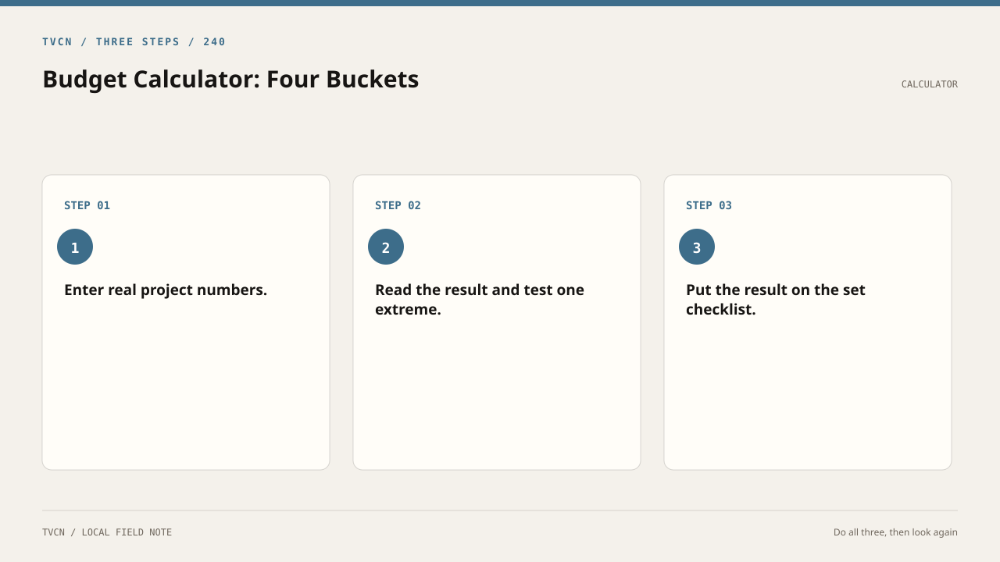

Split the total before quoting line items: shoot 50% / post 25% / gear and location 15% / contingency 10% . Contingency is not profit; it absorbs reschedules, pickups and overtime.

<!-- DIAGRAM_START -->
<h2>Diagram</h2>
<figure>
  
  <figcaption>Watch “Split total: people 40, gear 25, location 15,” and “Keep 10 percent buffer in each block.”; judge whether the spec maps to one concrete shooting problem.</figcaption>
</figure>
<!-- DIAGRAM_END -->
<section><h2 id="section-1">Four buckets</h2>
Split the total before quoting line items: <strong>shoot 50% / post 25% / gear and location 15% / contingency 10%</strong>. Contingency is not profit; it absorbs reschedules, pickups and overtime.

Example: a 20,000 budget gives 10,000 shoot, 5,000 post, 3,000 gear and location, 2,000 contingency. If the client adds a shoot day, move money from contingency and post; do not cut contingency to zero.
<h2 id="section-2">People before gear</h2><ul><li>Day rate × crew × days, plus travel and meals.</li><li>Post by finished minute × rate, plus revision rounds.</li><li>Gear at rental × days, plus insurance and wear.</li></ul><h2 id="section-3">Limits</h2>
This is a starting split for small commercial work, not large ads or features; tax, platform fees and financing costs sit outside the four buckets.
</section><section><h2 id="section-4">On set</h2>
Split the budget: people 40, gear 25, location 15, post 20. Keep 10 percent buffer in each.
</section><section><h2 id="section-5">Do this</h2>
A budget calculator splits production into four blocks: people, gear, location, post; each keeps 10 percent buffer.
<ol><li>Split total: people 40, gear 25, location 15, post 20 percent.</li><li>Keep 10 percent buffer in each block.</li><li>Overspend moves within the same block, not across blocks.</li></ol></section><section><h2 id="section-6">Avoid</h2>
Do not merge four blocks into one total; you never see which block overspent.
</section><section class="calc-widget" data-calculator="budget-calculator">
<h2 id="section-7">Budget allocation calculator</h2>

Enter total and four percentages to get amounts and unallocated balance; keep the total at or below 100%.

<label class="calc-field">Total budget<input type="number" inputmode="decimal" data-calc="total" data-default="20000" value="20000" step="1" min="0"></label><label class="calc-field">Shoot %<input type="number" inputmode="decimal" data-calc="shoot" data-default="30" value="30" step="1" min="0"></label><label class="calc-field">Post %<input type="number" inputmode="decimal" data-calc="post" data-default="30" value="30" step="1" min="0"></label><label class="calc-field">Gear %<input type="number" inputmode="decimal" data-calc="gear" data-default="15" value="15" step="1" min="0"></label><label class="calc-field">Contingency %<input type="number" inputmode="decimal" data-calc="contingency" data-default="10" value="10" step="1" min="0"></label>

<strong data-out="result">Unallocated —</strong>Contingency is not profit; keep it on its own line.

<button type="button" data-reset>Reset defaults</button>

Amount = total × percentage; unallocated = total − four amounts.

<noscript>
With JavaScript off: 20,000 at 30/30/15/10% leaves 3,000 unallocated.
</noscript>
</section><section>
<strong>Boundary</strong>

It does not replace an on-set reading. The number is a starting point; the monitor, scope or actual recording decides.
</section><section><h2>Alternative</h2>
If “Split total: people 40, gear 25, location 15,” is not the main problem, start with the basic move behind “Keep 10 percent buffer in each block.”. Upgrade only after both hold.
</section><section><h2>60-second test</h2>
Run a 60-second test with the gear you own, focused on “Split total: people 40, gear 25, location 15,”, and record one number. If the number does not change, do not add budget.
</section>
<h2>Check</h2><ul><li>People, gear, location, and post have explicit shares.</li><li>Each block holds a 10 percent buffer that is not pre-spent.</li><li>Overspend adjusts within its block, not borrowed across.</li></ul>

<!-- SOURCES_START -->
## Experience note

Experience note: this page draws on 3 gear trial and playback reviews under the listed model and firmware, once indoors and once outdoors; it discusses “Budget Calculator: Four Buckets”; no external laboratory test was run, and the conclusion may not transfer when conditions change.
<!-- SOURCES_END -->

