<!-- DIAGRAM_START -->
<h2>Diagram</h2>
<figure>
  
  <figcaption>Diagram: people, gear, location, post, and contingency each have a cap; quote revisions, rights, and rush separately.</figcaption>
</figure>
<!-- DIAGRAM_END -->
<h2>Find the stop-shoot line before the total</h2>
The first number is not the total; it is the line that stops the shoot if exceeded. Cast dates, location permits, gear rental, and key crew time can each stop production. Write those four as hard limits before allocating anything else.

Contingency is not what is left over; it is 10–15% held before the shoot. A budget without contingency pushes risk onto the shoot day.
<h2>Five blocks: every block needs a cap</h2>
People, gear, location, post, and contingency each get a cap and a cut order. When a client cuts budget, do not subtract from the total; name the block, the days, or the versions removed. A quote that cannot show the cut returns as overtime and rework.

Gear is rental price, not purchase; location is per day with transport and restoration; post is per version without unlimited revisions. “Excludes” matters more than “includes.”
<h2>Quote: revisions, rights, and rush are separate lines</h2>
Four quote blocks: production, post, rights/materials, and rush/overtime. Revisions are numeric: two rough-cut rounds, one fine-cut, one caption pass; extra rounds are priced per day or version. Music, fonts, and footage are separate from production.

Confirm payment milestones before quoting: deposit, shoot, first cut, delivery. A quote without milestones is a document that can be delayed forever.
<h2>Failure case: one missing “re-cut excluded”</h2>
A product film quoted three cuts, but the contract said only “post editing” with no revision count. The client changed seven versions, each adding a scene. The studio avoided charging and traded two weeks of free re-cuts for a verbal “we'll call you again.”

The fix is not an argument; it is version and revision terms in the next quote. Log every revision with date, content, and duration; stop beyond the contracted rounds and confirm a new quote before continuing.
<h2>Cost and acceptance</h2>
Budget templates by scale: small ¥3,000–15,000, mid ¥15,000–60,000, large ¥60,000–300,000+. Quote margin is often 15–30%, but contingency is not margin; it is the project’s own insurance.
<h2>Check</h2><ul><li>Four stop-shoot lines are written.</li><li>Five blocks each have a cap and cut order.</li><li>Contingency is 10–15%, not margin.</li><li>Quote splits production, post, rights, and rush.</li><li>Revision rounds are numeric with overage pricing.</li><li>Payment milestones have dates.</li></ul>
<!-- SOURCES_START -->
<h2>Sources</h2>

Experience: field notes and buying checklists; tested: short tests against public specs, not lab scores; references: manufacturer and standards links below.

<ul><li>[S23] SMPTE Standards</li><li>[S25] ITU-R BT.709</li><li>[S26] ITU-R BT.2020</li><li>[S29] YouTube Upload Specs</li><li>[S38] State Taxation Administration</li></ul>

<a href="../../SOURCES.md">Full links and notes in SOURCES.md</a>

<!-- SOURCES_END -->
