<!-- DIAGRAM_START -->
<h2>Diagram</h2>
<figure>
  
  <figcaption>Diagram: channels, 32-bit, timecode, power, and backup decide whether the set delivers.</figcaption>
</figure>
<!-- DIAGRAM_END -->
<h2>First decision: which link is missing</h2>
Two people indoors: two channels are enough. Multicam/multiple outdoor subjects: at least four channels plus timecode. 32-bit float saves gain errors, not a misplaced mic; do not treat it as magic.

<strong>Fits:</strong>
<ul><li>Two/multiple speakers, independent gain</li><li>Multicam timecode sync</li><li>Uncontrolled exterior, 32-bit safety</li></ul>
<strong>Does not fit:</strong>
<ul><li>Solo voiceover, phone is enough</li><li>Only camera reference audio</li><li>No post, direct delivery</li></ul><h2>Test protocol: reproducible, no invented scores</h2>
Connect two mics, one normal and one 20dB low, then shout to see whether 32-bit saves it. Pull one card and check recording continues on the other. Feed timecode to camera and shoot 30 seconds to sync.

<table class="data-table"><thead><tr><th>Check</th><th>Pass line</th><th>Reference/log</th></tr></thead><tbody><tr><td>通道</td><td>两路独立增益，互不影响</td><td>双人对话</td></tr><tr><td>32-bit</td><td>大声不削波，回放可恢复</td><td>低增益+喊话</td></tr><tr><td>时码</td><td>相机与录机 30 秒无漂移</td><td>时码线</td></tr><tr><td>供电</td><td>整日 8 小时可换电</td><td>电池仓</td></tr><tr><td>备份</td><td>拔卡不断录/安全轨</td><td>双卡测试</td></tr></tbody></table>
<h2>Price bands: total cost of ownership first</h2>
Look beyond the sticker: cards, batteries, adapters, gimbal, stands, software subscriptions, and repair. Bands describe the minimum kit for a real project type, not toy pricing.

<table class="data-table"><thead><tr><th>Tier</th><th>Reference</th><th>Includes</th><th>Watch</th></tr></thead><tbody><tr><td>Entry</td><td>¥1,500–4,000</td><td>2-channel + 32-bit + basic mic</td><td>Timecode/dual card often missing</td></tr><tr><td>Main</td><td>¥4,000–10,000</td><td>4-channel + timecode + dual card + monitor</td><td>Wireless/mics extra</td></tr><tr><td>Advanced</td><td>¥10,000–30,000</td><td>8-channel, pro timecode, redundant power</td><td>Weight and rig</td></tr></tbody></table>

Prices are China mainland channel references as of November 2026; tax and quotes vary. Not buying advice.
<h2>Alternatives and upgrades: do not add money on the wrong axis</h2><ul><li>Camera + small 32-bit recorder</li><li>Rent a multichannel recorder</li><li>Dual-system with clap sync</li></ul><h2>Buying steps: bring footage, not spec sheets</h2>
Run these in order before paying. If one fails, do not tell yourself post will fix it.
<ol><li>Two mics, independent gain</li><li>Low gain + shout for 32-bit</li><li>Pull a card mid-record</li><li>30-second timecode test</li><li>Price batteries and cards</li></ol><h2>Check</h2><ul><li>At least two independent gains.</li><li>32-bit saves a loud clipping take.</li><li>Timecode stable for 30 seconds.</li><li>Card pull keeps recording or safety track.</li><li>Full-day power is swappable.</li><li>Headphone monitoring exists.</li></ul>

> Intent split: this page covers the practical details of “Field Recorder: Channels, 32-bit Float, and Timecode”; start with <a href="https://tools.tvcn.org/article/lav-hidden/">Lav Hiding: Collar, Hair, Tape</a> for the cluster-level judgement, then return here.

<!-- INTENT_SCOPE -->

<!-- SOURCES_START -->
## References and further reading

- [S27] [ITU-R BS.1770: Loudness and True Peak](https://www.itu.int/rec/R-REC-BS.1770/en) — Accessed 2026-11-26. Used to check the terminology/method/rule in the “First decision: which link is missing” section against BS.1770 loudness measurement, not microphone buying advice; it does not verify numbers, model choices or on-set conclusions derived from this page, and is not a substitute for a test.
- [S23] [SMPTE: Standards](https://www.smpte.org/standards) — Accessed 2026-11-26. Used to check the terminology/method/rule in the “Test protocol: reproducible, no invented scores” section against SMPTE standards portal, not specific camera specs; it does not verify numbers, model choices or on-set conclusions derived from this page, and is not a substitute for a test.
<!-- SOURCES_END -->

