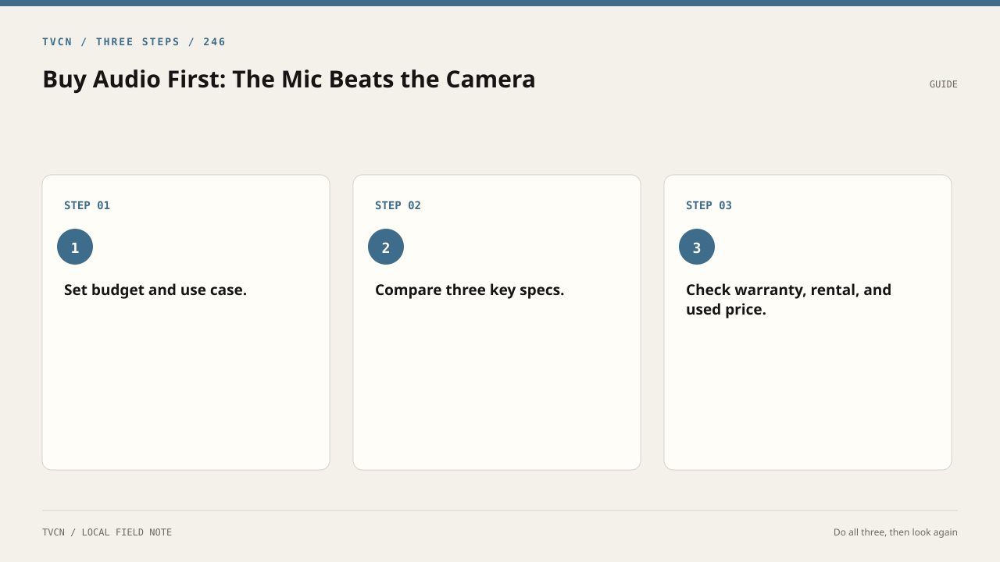

Audio before camera: viewers forgive ordinary images, not unintelligible sound.

<!-- DIAGRAM_START -->
<h2>Diagram</h2>
<figure>
  
  <figcaption>Do the three steps in order, then look again at the image or file.</figcaption>
</figure>
<!-- DIAGRAM_END -->
<h2>On set</h2>

Buy a lav or shotgun mic and a recorder first. Put the money in sound, not the body.

<h2>Do this</h2>

Sound before body. The audience tolerates an ordinary image but not unintelligible dialogue.
<ol><li>Buy a lav or shotgun mic and a recorder first.</li><li>Put half the budget into mic and recorder, thirty percent into light, twenty percent into body accessories.</li><li>Shoot an indoor and outdoor comparison and confirm clean dialogue.</li></ol>
<h2>Avoid</h2>

Do not put all the money into the body; bad sound makes a good image unwatchable.

<h2>Check</h2>
<ul><li>The mic and recorder were bought first.</li><li>Half the budget went to sound, thirty percent to light, twenty to accessories.</li><li>Indoor and outdoor tests confirm clean dialogue.</li></ul>
