<!-- DIAGRAM_START -->
<h2>Diagram</h2>
<figure>
  
  <figcaption>Diagram: capacity, voltage, communication, charging, and swelling decide whether a pack leaves the house.</figcaption>
</figure>
<!-- DIAGRAM_END -->
<h2>First decision: which link is missing</h2>
Prefer OEM or certified third-party for camera packs; for V-mount, check cells and BMS, not only Wh. Carry at least 2.5× expected draw for a shoot day, with margin in extreme temperatures. Stop using any pack that swells, cuts out, or miscommunicates.

<strong>Fits:</strong>
<ul><li>Full-day shoots, reliable power</li><li>Cold/heat environments</li><li>Multicam, common batteries</li></ul>
<strong>Does not fit:</strong>
<ul><li>Short clips only</li><li>Uncertified bargain packs</li><li>Already swollen old packs</li></ul><h2>Test protocol: reproducible, no invented scores</h2>
Fully charge, record until shutdown, and log actual runtime vs rating. Watch voltage under load. Check percentage/temperature in camera. Feel charge temperature and inspect for swelling.

<table class="data-table"><thead><tr><th>Check</th><th>Pass line</th><th>Reference/log</th></tr></thead><tbody><tr><td>容量</td><td>实测达标称 80%</td><td>连续录制</td></tr><tr><td>电压</td><td>负载下不骤跌</td><td>录制中读</td></tr><tr><td>通信</td><td>电量/温度正常显示</td><td>机内</td></tr><tr><td>充电</td><td>认证充电器，时间正常</td><td>充电记录</td></tr><tr><td>胀包</td><td>无鼓包/漏液/异味</td><td>外观/手感</td></tr></tbody></table>
<h2>Price bands: total cost of ownership first</h2>
Look beyond the sticker: cards, batteries, adapters, gimbal, stands, software subscriptions, and repair. Bands describe the minimum kit for a real project type, not toy pricing.

<table class="data-table"><thead><tr><th>Tier</th><th>Reference</th><th>Includes</th><th>Watch</th></tr></thead><tbody><tr><td>Entry</td><td>¥150–400</td><td>Certified third-party small pack</td><td>Limited communication/life</td></tr><tr><td>Main</td><td>¥400–1,200</td><td>OEM/certified high capacity</td><td>Rotate several</td></tr><tr><td>Advanced</td><td>¥1,200–3,000</td><td>V-mount/pro BMS</td><td>Charger and transport</td></tr></tbody></table>

Prices are China mainland channel references as of November 2026; tax and quotes vary. Not buying advice.
<h2>Alternatives and upgrades: do not add money on the wrong axis</h2><ul><li>Rent V-mount for a project</li><li>Dummy battery + mains</li><li>Charging station + several small packs</li></ul><h2>Buying steps: bring footage, not spec sheets</h2>
Run these in order before paying. If one fails, do not tell yourself post will fix it.
<ol><li>Record to shutdown</li><li>Read voltage under load</li><li>Check camera communication</li><li>Charge heat/swelling</li><li>Calculate 2.5× daily draw</li></ol><h2>Check</h2><ul><li>80% of rated capacity.</li><li>Voltage holds under load.</li><li>Percentage/temperature readable.</li><li>No abnormal charge heat.</li><li>No swelling/leak.</li><li>2.5× daily draw in spares.</li></ul>
<!-- SOURCES_START -->
<h2>Sources</h2>

Experience: field notes and buying checklists; tested: short tests against public specs, not lab scores; references: manufacturer and standards links below.

<ul><li>[S23] SMPTE Standards</li><li>[S25] ITU-R BT.709</li><li>[S26] ITU-R BT.2020</li><li>[S29] YouTube Upload Specs</li><li>[S38] State Taxation Administration</li></ul>

<a href="../../SOURCES.md">Full links and notes in SOURCES.md</a>

<!-- SOURCES_END -->
