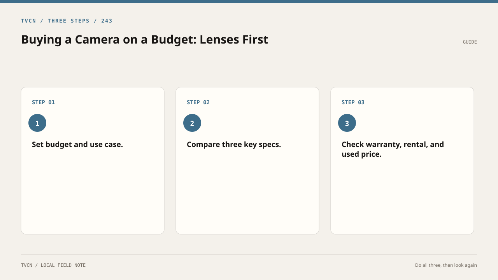

<!-- DIAGRAM_START -->
<h2>Diagram</h2>
<figure>
  
  <figcaption>Diagram: five pass lines decide whether a camera can take paid work, better than a spec sheet.</figcaption>
</figure>
<!-- DIAGRAM_END -->
<h2>First decision: which link is missing</h2>
If you already have a 4K body and one working lens, do not replace the body first. Ask which of your last three films was lost because the camera was not enough. Low light: fast lens and light first. Audio: microphone first. Autofocus: then the body. Under ¥10k, the body should not exceed half the budget.

<strong>Fits:</strong>
<ul><li>First paid work, ¥8,000–20,000</li><li>Interview, event, product, 4K delivery</li><li>10-bit/Log for a simple grade</li></ul>
<strong>Does not fit:</strong>
<ul><li>4K120 or global shutter</li><li>One hour without overheating</li><li>RAW and dual-card recording</li></ul><h2>Test protocol: reproducible, no invented scores</h2>
Bring your own Log footage and a 64GB card. Spend five minutes on each of the five checks. Do not just hold the body and listen to the shutter; a spec sheet will not show rolling shutter, heat, or AF breathing.

<table class="data-table"><thead><tr><th>Check</th><th>Pass line</th><th>Reference/log</th></tr></thead><tbody><tr><td>果冻效应</td><td>快速横摇时直线可接受，不变成斜塔</td><td>拍一段 2 秒横摇，回放</td></tr><tr><td>过热</td><td>4K 30p 连续 30 分钟不报警</td><td>室温 25°C，记录起始电量</td></tr><tr><td>自动对焦</td><td>人眼/物体切换不呼吸、不拉风箱</td><td>暗光 + 逆光各一次</td></tr><tr><td>电池</td><td>实际录制 90 分钟以上</td><td>原厂电池，关闭省电</td></tr><tr><td>音频</td><td>有耳机监听、手动增益、底噪可控</td><td>接一支动圈/领夹试录</td></tr></tbody></table>
<h2>Price bands: total cost of ownership first</h2>
Look beyond the sticker: cards, batteries, adapters, gimbal, stands, software subscriptions, and repair. Bands describe the minimum kit for a real project type, not toy pricing.

<table class="data-table"><thead><tr><th>Tier</th><th>Reference</th><th>Includes</th><th>Watch</th></tr></thead><tbody><tr><td>Entry</td><td>¥4,000–8,000</td><td>APS-C + kit lens + one card/battery</td><td>Limited low light/AF</td></tr><tr><td>Main</td><td>¥8,000–20,000</td><td>Full-frame/APS-C video body + prime + spare</td><td>Lens/storage extra</td></tr><tr><td>Advanced</td><td>¥20,000–50,000</td><td>10-bit/RAW, dual card, monitor, audio</td><td>Accessories may exceed body</td></tr></tbody></table>

Prices are China mainland channel references as of November 2026; tax and quotes vary. Not buying advice.
<h2>Alternatives and upgrades: do not add money on the wrong axis</h2><ul><li>A fast prime first</li><li>An audio kit first</li><li>A used previous-gen flagship</li></ul><h2>Buying steps: bring footage, not spec sheets</h2>
Run these in order before paying. If one fails, do not tell yourself post will fix it.
<ol><li>Rent one day in your usual scene</li><li>Test adapters and AF with your lenses</li><li>Confirm HDMI, monitoring, and power</li><li>Price cards, batteries, cage, monitor</li><li>Check warranty and repair turnaround</li></ol><h2>Check</h2><ul><li>Body is at most half the total budget.</li><li>Five tests have footage logs.</li><li>Total includes cards, batteries, monitor, adapters.</li><li>At least one lens covers the main scene.</li><li>Heat and rolling shutter are acceptable.</li><li>Warranty and repair turnaround are known.</li></ul>
<!-- SOURCES_START -->
<h2>Sources</h2>

Experience: field notes and buying checklists; tested: short tests against public specs, not lab scores; references: manufacturer and standards links below.

<ul><li>[S23] SMPTE Standards</li><li>[S25] ITU-R BT.709</li><li>[S26] ITU-R BT.2020</li><li>[S29] YouTube Upload Specs</li><li>[S38] State Taxation Administration</li></ul>

<a href="../../SOURCES.md">Full links and notes in SOURCES.md</a>

<!-- SOURCES_END -->
