<!-- DIAGRAM_START -->
<h2>Diagram</h2>
<figure>
  
  <figcaption>Diagram: shooting is not delivering. A missing item becomes a post cost.</figcaption>
</figure>
<!-- DIAGRAM_END -->
<h2>First decision: which link is missing</h2>
Start with delivery: does the client need RAW, HDR, or multicam timecode? If all three are no, a cinema camera is likely overkill. Log, 10-bit, and interchangeable lenses on a high-end video body with external recording may be enough. Cinema cameras sell dynamic range, timecode, SDI, and a repairable rig ecosystem—not a professional look.

<strong>Fits:</strong>
<ul><li>Ads/short films needing RAW or latitude</li><li>Multicam with timecode and SDI</li><li>A rigged, serviceable long-term system</li></ul>
<strong>Does not fit:</strong>
<ul><li>Events/interviews delivered Rec.709</li><li>Solo run-and-gun, weight-sensitive</li><li>Budget only covers the body</li></ul><h2>Test protocol: reproducible, no invented scores</h2>
Do not judge dynamic range by a number. Bring a bright window and a face in shadow, shoot 30 seconds in the project codec, and check highlight recovery, shadow noise, and rig balance.

<table class="data-table"><thead><tr><th>Check</th><th>Pass line</th><th>Reference/log</th></tr></thead><tbody><tr><td>高光</td><td>窗外可回收 2 档，不出现硬切</td><td>Log/RAW 实拍</td></tr><tr><td>暗部</td><td>ISO 测试下肤色噪点可接受</td><td>双原生 ISO 对比</td></tr><tr><td>时码</td><td>输入/输出与录机一致</td><td>时码发生器</td></tr><tr><td>介质</td><td>项目编码持续写入不丢帧</td><td>满卡测试</td></tr><tr><td>套件</td><td>肩扛/手提 10 分钟不失衡</td><td>实际配重</td></tr></tbody></table>
<h2>Price bands: total cost of ownership first</h2>
Look beyond the sticker: cards, batteries, adapters, gimbal, stands, software subscriptions, and repair. Bands describe the minimum kit for a real project type, not toy pricing.

<table class="data-table"><thead><tr><th>Tier</th><th>Reference</th><th>Includes</th><th>Watch</th></tr></thead><tbody><tr><td>Entry</td><td>¥15,000–35,000</td><td>Body + one card + basic rig</td><td>Monitor/power often underestimated</td></tr><tr><td>Main</td><td>¥35,000–80,000</td><td>Body + dual card + monitor + batteries + handle</td><td>Cables/baseplate extra</td></tr><tr><td>Advanced</td><td>¥80,000–200,000</td><td>RAW recorder, timecode, wireless focus, pro rig</td><td>Weight and crew cost rise</td></tr></tbody></table>

Prices are China mainland channel references as of November 2026; tax and quotes vary. Not buying advice.
<h2>Alternatives and upgrades: do not add money on the wrong axis</h2><ul><li>High-end video body + external recorder</li><li>Used previous-gen cinema camera</li><li>Rent body, buy lens/rig</li></ul><h2>Buying steps: bring footage, not spec sheets</h2>
Run these in order before paying. If one fails, do not tell yourself post will fix it.
<ol><li>Shoot 30 seconds in project codec</li><li>Build the rig and weigh it</li><li>Confirm card price and sustained write</li><li>Confirm monitor, power, cable interfaces</li><li>Check service and backup body</li></ol><h2>Check</h2><ul><li>Project truly needs at least two of RAW/timecode/SDI.</li><li>Body, rig, and media total is known.</li><li>Highlight and shadow recovery tested.</li><li>Timecode passes with recorder/multicam.</li><li>Rig weight is manageable.</li><li>Service point or backup body exists.</li></ul>

> Intent split: this page covers the practical details of “Buying a Cinema Camera: “Can Shoot” Is Not “Can Deliver””; start with <a href="https://tools.tvcn.org/article/buy-camera-budget/">Buying a Camera: Budget Before Body</a> for the cluster-level judgement, then return here.

<!-- INTENT_SCOPE -->

<!-- SOURCES_START -->
## References and further reading

- [S23] [SMPTE Standards](https://www.smpte.org/standards) — Accessed 2026-11-26. Used to check the terminology and public context in the opening paragraph (“A cinema camera’s price is not the body: cards, batteries, m”) against Entry point for timecode, color, cinema and signal-chain standards; not a substitute for an on-set test.
- [S25] [ITU-R BT.709](https://www.itu.int/rec/R-REC-BT.709/en) — Accessed 2026-11-26. Used to check the terminology and public context in the opening paragraph (“A cinema camera’s price is not the body: cards, batteries, m”) against HD SDR gamut, transfer function and viewing conditions; not a substitute for an on-set test.
- [S26] [ITU-R BT.2020](https://www.itu.int/rec/R-REC-BT.2020/en) — Accessed 2026-11-26. Used to check the terminology and public context in the opening paragraph (“A cinema camera’s price is not the body: cards, batteries, m”) against Wide-gamut and parameter definitions for UHD/HDR; not a substitute for an on-set test.
- [S29] [YouTube Upload Specs](https://support.google.com/youtube/answer/1722171) — Accessed 2026-11-26. Used to check the terminology and public context in the opening paragraph (“A cinema camera’s price is not the body: cards, batteries, m”) against Recommended resolution, bitrate, frame rate and audio codec; not a substitute for an on-set test.
- [S38] [State Taxation Administration: Official site](https://www.chinatax.gov.cn/) — Accessed 2026-11-26. Used to check the terminology and public context in the opening paragraph (“A cinema camera’s price is not the body: cards, batteries, m”) against Official entry for VAT, cross-border services and withholding; not a substitute for an on-set test.
<!-- SOURCES_END -->

