<!-- DIAGRAM_START -->
<h2>Diagram</h2>
<figure>
  
  <figcaption>Diagram: payload, balance, locks, follow, and battery decide whether it survives a walking shot.</figcaption>
</figure>
<!-- DIAGRAM_END -->
<h2>First decision: which link is missing</h2>
Decide whether you need walking follow or locked-off motion. The former needs follow and locks; the latter needs payload and low angles. Keep the rig under 70% of the rating; otherwise balance and motor headroom disappear.

<strong>Fits:</strong>
<ul><li>Solo walking follow</li><li>Product/space motion</li><li>Limited budget, one general gimbal</li></ul>
<strong>Does not fit:</strong>
<ul><li>Long lens/heavy cinema rig</li><li>High-speed chase/extreme sports</li><li>Millimetre-repeatable motion</li></ul><h2>Test protocol: reproducible, no invented scores</h2>
Mount and balance the rig. Release each axis and check drift. Lock each axis and check play. Turn quickly and check follow lag. Run 30 minutes and check battery and motor heat.

<table class="data-table"><thead><tr><th>Check</th><th>Pass line</th><th>Reference/log</th></tr></thead><tbody><tr><td>承重</td><td>整机不超过标称 70%</td><td>整机称重</td></tr><tr><td>调平</td><td>三轴松手 5 秒不漂</td><td>逐轴调平</td></tr><tr><td>轴锁</td><td>锁死无松动</td><td>手持轻推</td></tr><tr><td>跟随</td><td>快速转向不滞后/不抖</td><td>走动测试</td></tr><tr><td>电池</td><td>实测 4 小时以上</td><td>30 分钟记录</td></tr></tbody></table>
<h2>Price bands: total cost of ownership first</h2>
Look beyond the sticker: cards, batteries, adapters, gimbal, stands, software subscriptions, and repair. Bands describe the minimum kit for a real project type, not toy pricing.

<table class="data-table"><thead><tr><th>Tier</th><th>Reference</th><th>Includes</th><th>Watch</th></tr></thead><tbody><tr><td>Entry</td><td>¥800–2,000</td><td>Phone/mirrorless gimbal</td><td>Limited payload/follow</td></tr><tr><td>Main</td><td>¥2,000–5,000</td><td>Mirrorless/small cinema gimbal</td><td>Battery/accessories</td></tr><tr><td>Advanced</td><td>¥5,000–15,000</td><td>Pro gimbal/remote focus</td><td>Weight and crew</td></tr></tbody></table>

Prices are China mainland channel references as of November 2026; tax and quotes vary. Not buying advice.
<h2>Alternatives and upgrades: do not add money on the wrong axis</h2><ul><li>Rent one for a project</li><li>Tripod + slider</li><li>Used previous-gen flagship</li></ul><h2>Buying steps: bring footage, not spec sheets</h2>
Run these in order before paying. If one fails, do not tell yourself post will fix it.
<ol><li>Weigh the rig</li><li>Balance each axis</li><li>Lock and push</li><li>Fast turn follow</li><li>30-min battery/heat</li></ol><h2>Check</h2><ul><li>Rig under 70% rating.</li><li>Axes do not drift on release.</li><li>Locks have no play.</li><li>Fast turn does not lag.</li><li>4+ hours real runtime.</li><li>Motors are not hot after balance.</li></ul>
<!-- SOURCES_START -->
<h2>Sources</h2>

Experience: field notes and buying checklists; tested: short tests against public specs, not lab scores; references: manufacturer and standards links below.

<ul><li>[S23] SMPTE Standards</li><li>[S25] ITU-R BT.709</li><li>[S26] ITU-R BT.2020</li><li>[S29] YouTube Upload Specs</li><li>[S38] State Taxation Administration</li></ul>

<a href="../../SOURCES.md">Full links and notes in SOURCES.md</a>

<!-- SOURCES_END -->
