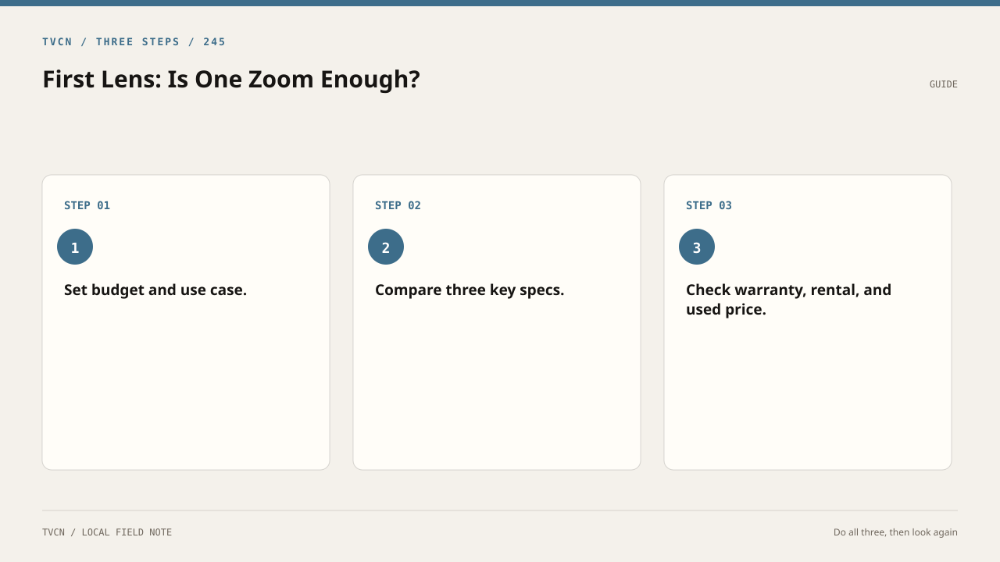

<!-- DIAGRAM_START -->
<h2>Diagram</h2>
<figure>
  
  <figcaption>Diagram: focal length, aperture, breathing, close focus, and filter size decide whether it becomes a main lens.</figcaption>
</figure>
<!-- DIAGRAM_END -->
<h2>First decision: which link is missing</h2>
List the focal lengths in your last 20 films. If 35mm and 50mm dominate, buy a fast 35 or 50 first. If you shoot events and cannot move, consider a 24-70 zoom. The first lens should not exceed 60% of the budget; leave money for a second lens or light.

<strong>Fits:</strong>
<ul><li>Portrait/interview, shallow depth</li><li>Low-light interiors, no light</li><li>One lens to build a look</li></ul>
<strong>Does not fit:</strong>
<ul><li>Events/sports needing fast zoom</li><li>Product macro at 1:1</li><li>One ultra-wide for everything</li></ul><h2>Test protocol: reproducible, no invented scores</h2>
Bring the body and shoot three frames: a face, a hand detail, and a backlit window. Check edges, chromatic aberration, focus breathing, and vignetting—not only centre sharpness.

<table class="data-table"><thead><tr><th>Check</th><th>Pass line</th><th>Reference/log</th></tr></thead><tbody><tr><td>焦段</td><td>在常用场景中不用频繁换镜</td><td>一天拍摄记录</td></tr><tr><td>光圈</td><td>常用光线下 ISO 不超过 3200</td><td>暗光人像</td></tr><tr><td>呼吸</td><td>推拉焦时构图变化可接受</td><td>近距对焦视频</td></tr><tr><td>最近对焦</td><td>能拍手/产品，不撞镜头</td><td>尺子/产品</td></tr><tr><td>滤镜</td><td>与现有 77/82mm 通用</td><td>口径与转接</td></tr></tbody></table>
<h2>Price bands: total cost of ownership first</h2>
Look beyond the sticker: cards, batteries, adapters, gimbal, stands, software subscriptions, and repair. Bands describe the minimum kit for a real project type, not toy pricing.

<table class="data-table"><thead><tr><th>Tier</th><th>Reference</th><th>Includes</th><th>Watch</th></tr></thead><tbody><tr><td>Entry</td><td>¥1,500–4,000</td><td>One domestic/used fast prime</td><td>Test breathing and edges</td></tr><tr><td>Main</td><td>¥4,000–12,000</td><td>OEM 35/50/85 or 24-70 F2.8</td><td>Weight vs price</td></tr><tr><td>Advanced</td><td>¥12,000–30,000</td><td>Cine lens/high-end zoom</td><td>Rig and follow focus extra</td></tr></tbody></table>

Prices are China mainland channel references as of November 2026; tax and quotes vary. Not buying advice.
<h2>Alternatives and upgrades: do not add money on the wrong axis</h2><ul><li>Rent three, buy after</li><li>Used OEM prime</li><li>Add light instead of glass</li></ul><h2>Buying steps: bring footage, not spec sheets</h2>
Run these in order before paying. If one fails, do not tell yourself post will fix it.
<ol><li>List focal lengths from 20 films</li><li>Shoot face/hand/backlight</li><li>Compare breathing and close focus</li><li>Check filters and hood</li><li>Check warranty/used glass</li></ol><h2>Check</h2><ul><li>First lens covers 70% of work.</li><li>ISO is acceptable in low light.</li><li>Breathing does not hurt video focus.</li><li>Close focus handles product/hands.</li><li>Filter size matches existing kit.</li><li>40% of budget remains for a second lens/light.</li></ul>

<!-- SOURCES_START -->
## References and further reading

- [S31] [ARRI: Cine Systems](https://www.arri.com/en/cine-systems) — Accessed 2026-11-26. Used to check the terminology/method/rule in the “First decision: which link is missing” section against ARRI camera, lens and lighting documentation, not a general shooting tutorial; it does not verify numbers, model choices or on-set conclusions derived from this page, and is not a substitute for a test.
- [S52] [ARRI: ALEXA 35](https://www.arri.com/en/camera-systems/cameras/legacy-camera-systems/alexa-35) — Accessed 2026-11-26. Used to check the terminology/method/rule in the “Buying steps: bring footage, not spec sheets” section against ALEXA 35 official specs, not independent testing; it does not verify numbers, model choices or on-set conclusions derived from this page, and is not a substitute for a test.
- [S53] [Sony: FX6](https://pro.sony/ue_US/products/handheld-camcorders/ilme-fx6v) — Accessed 2026-11-26. Used to check the terminology/method/rule in the “Test protocol: reproducible, no invented scores” section against FX6 official specs, not independent testing; it does not verify numbers, model choices or on-set conclusions derived from this page, and is not a substitute for a test.
<!-- SOURCES_END -->

