<!-- DIAGRAM_START -->
<h2>Diagram</h2>
<figure>
  
  <figcaption>Diagram: parfocal, breathing, servo, weight, and filter decide whether it saves time on a real shoot.</figcaption>
</figure>
<!-- DIAGRAM_END -->
<h2>First decision: which link is missing</h2>
Zooms suit events, weddings, documentary, and solo moving work; they do not suit maximum shallow depth or minimum weight. Decide the range: 24-70 covers most, 70-200 suits stage/events, 18-35 suits spaces. Do not buy one 18-300 as everything.

<strong>Fits:</strong>
<ul><li>Events/weddings, no lens changes</li><li>Solo moving, efficiency</li><li>Documentary, fast framing</li></ul>
<strong>Does not fit:</strong>
<ul><li>Maximum aperture/shallow depth</li><li>Long handheld, weight-sensitive</li><li>Macro/extreme close focus</li></ul><h2>Test protocol: reproducible, no invented scores</h2>
Focus at the long end, zoom wide, and see if focus holds. Then push/pull close and watch breathing. Finally record a zoom and listen to the servo.

<table class="data-table"><thead><tr><th>Check</th><th>Pass line</th><th>Reference/log</th></tr></thead><tbody><tr><td>齐焦</td><td>长焦对焦后拉广，焦点仍在</td><td>现场推拉</td></tr><tr><td>呼吸</td><td>近距推拉构图不明显缩放</td><td>1 米测试</td></tr><tr><td>伺服</td><td>速度可调，录音无咔哒</td><td>机头麦测试</td></tr><tr><td>重量</td><td>手持 5 分钟不抖</td><td>上机称重</td></tr><tr><td>滤镜</td><td>77/82mm 与现有通用</td><td>口径与转接</td></tr></tbody></table>
<h2>Price bands: total cost of ownership first</h2>
Look beyond the sticker: cards, batteries, adapters, gimbal, stands, software subscriptions, and repair. Bands describe the minimum kit for a real project type, not toy pricing.

<table class="data-table"><thead><tr><th>Tier</th><th>Reference</th><th>Includes</th><th>Watch</th></tr></thead><tbody><tr><td>Entry</td><td>¥2,000–6,000</td><td>24-70/28-75 F2.8 domestic/used</td><td>Test parfocal/breathing</td></tr><tr><td>Main</td><td>¥6,000–15,000</td><td>OEM 24-70 F2.8 / 70-200 F4</td><td>Weight and servo</td></tr><tr><td>Advanced</td><td>¥15,000–40,000</td><td>70-200 F2.8 / cine zoom</td><td>Rig and follow focus</td></tr></tbody></table>

Prices are China mainland channel references as of November 2026; tax and quotes vary. Not buying advice.
<h2>Alternatives and upgrades: do not add money on the wrong axis</h2><ul><li>Two primes instead of one zoom</li><li>Rent a 70-200 for events</li><li>Start with a kit zoom</li></ul><h2>Buying steps: bring footage, not spec sheets</h2>
Run these in order before paying. If one fails, do not tell yourself post will fix it.
<ol><li>List three main scene types</li><li>Focus long, zoom wide</li><li>Close push/pull for breathing</li><li>Record servo noise</li><li>Weigh and hold five minutes</li></ol><h2>Check</h2><ul><li>Range covers main scenes.</li><li>Parfocal passes.</li><li>Breathing is acceptable.</li><li>Servo is quiet.</li><li>Handhold five minutes.</li><li>Filter size is reusable.</li></ul>
<!-- SOURCES_START -->
<h2>Sources</h2>

Experience: field notes and buying checklists; tested: short tests against public specs, not lab scores; references: manufacturer and standards links below.

<ul><li>[S23] SMPTE Standards</li><li>[S25] ITU-R BT.709</li><li>[S26] ITU-R BT.2020</li><li>[S29] YouTube Upload Specs</li><li>[S38] State Taxation Administration</li></ul>

<a href="../../SOURCES.md">Full links and notes in SOURCES.md</a>

<!-- SOURCES_END -->
