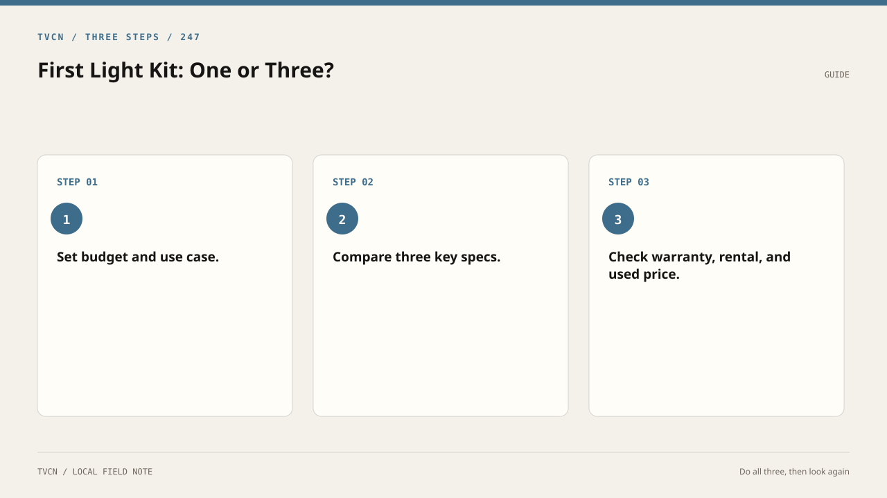

Start with one color-adjustable COB and a soft box; three cheap lights lose to one usable source.

<!-- DIAGRAM_START -->
<h2>Diagram</h2>
<figure>
  
  <figcaption>Do the three steps in order, then look again at the image or file.</figcaption>
</figure>
<!-- DIAGRAM_END -->
<h2>On set</h2>

Start with one 60W COB, a 90-centimeter softbox, and a stand. That covers interviews and half-body shots before a second light.

<h2>Do this</h2>

Start with one color-tunable COB and a softbox. Three cheap lights are worse than one usable light.
<ol><li>Choose a COB of at least 60W with a 2700 to 6500K range.</li><li>Add a 90cm softbox, stand, and sandbag.</li><li>Shoot half-body and interviews with one light first; add a second for an edge later.</li></ol>
<h2>Avoid</h2>

Do not buy three fixed-color panels; their ratio and color temperature will fight.

<h2>Check</h2>
<ul><li>A COB of at least 60W with a 2700 to 6500K range.</li><li>A 90cm softbox, stand, and sandbag are included.</li><li>One light handles half-body and interview; a second adds an edge.</li></ul>
