<!-- DIAGRAM_START -->
<h2>Diagram</h2>
<figure>
  
  <figcaption>Diagram: flicker, color, output, power, and control decide whether an LED is controllable on set.</figcaption>
</figure>
<!-- DIAGRAM_END -->
<h2>First decision: which link is missing</h2>
Confirm mains frequency and camera shutter. LED flicker is not “broken”; refresh and shutter mismatch. Test color shift while dimming, and test full-power battery runtime, not low-power claims.

<strong>Fits:</strong>
<ul><li>Indoor interview/product, dimming</li><li>Small crew, battery power</li><li>Wireless/DMX control</li></ul>
<strong>Does not fit:</strong>
<ul><li>Large sets needing tungsten/HMI</li><li>Extreme hot/cold exterior</li><li>Cheapest only, no modifiers</li></ul><h2>Test protocol: reproducible, no invented scores</h2>
Shoot ten seconds at 1/50, 1/60, and 1/125 and check banding. Set two lights to the same temperature, dim both 50%, and check color shift. Run one at full power on battery for 30 minutes and log drain.

<table class="data-table"><thead><tr><th>Check</th><th>Pass line</th><th>Reference/log</th></tr></thead><tbody><tr><td>频闪</td><td>1/50–1/125 无横纹</td><td>10 秒/档</td></tr><tr><td>色温</td><td>调光 100%→50% 不偏色</td><td>双灯对比</td></tr><tr><td>输出</td><td>柔光后 ISO 800 可用</td><td>测光表</td></tr><tr><td>供电</td><td>满功率 30 分钟掉电可接受</td><td>电池记录</td></tr><tr><td>控制</td><td>DMX/无线无延迟</td><td>现场调光</td></tr></tbody></table>
<h2>Price bands: total cost of ownership first</h2>
Look beyond the sticker: cards, batteries, adapters, gimbal, stands, software subscriptions, and repair. Bands describe the minimum kit for a real project type, not toy pricing.

<table class="data-table"><thead><tr><th>Tier</th><th>Reference</th><th>Includes</th><th>Watch</th></tr></thead><tbody><tr><td>Entry</td><td>¥800–2,500</td><td>One small COB/panel + diffusion</td><td>Test flicker/color</td></tr><tr><td>Main</td><td>¥2,500–8,000</td><td>Two bi-color + batteries + modifiers</td><td>DMX extra</td></tr><tr><td>Advanced</td><td>¥8,000–25,000</td><td>High output, RGB, DMX, pro modifiers</td><td>Weight and power distribution</td></tr></tbody></table>

Prices are China mainland channel references as of November 2026; tax and quotes vary. Not buying advice.
<h2>Alternatives and upgrades: do not add money on the wrong axis</h2><ul><li>Tungsten + diffusion</li><li>Rent high-output LED</li><li>Reflector + existing light</li></ul><h2>Buying steps: bring footage, not spec sheets</h2>
Run these in order before paying. If one fails, do not tell yourself post will fix it.
<ol><li>Flicker at 1/50–1/125</li><li>Two lights dim match</li><li>Full-power battery 30 min</li><li>Test DMX/wireless latency</li><li>Price modifiers</li></ol><h2>Check</h2><ul><li>No flicker at common shutters.</li><li>Dimming holds color.</li><li>Output works through diffusion.</li><li>Full-power runtime is known.</li><li>DMX/wireless control works.</li><li>Modifiers are included.</li></ul>
<!-- SOURCES_START -->
<h2>Sources</h2>

Experience: field notes and buying checklists; tested: short tests against public specs, not lab scores; references: manufacturer and standards links below.

<ul><li>[S23] SMPTE Standards</li><li>[S25] ITU-R BT.709</li><li>[S26] ITU-R BT.2020</li><li>[S29] YouTube Upload Specs</li><li>[S38] State Taxation Administration</li></ul>

<a href="../../SOURCES.md">Full links and notes in SOURCES.md</a>

<!-- SOURCES_END -->
