<!-- DIAGRAM_START -->
<h2>Diagram</h2>
<figure>
  
  <figcaption>Diagram: peak, black, gamut, tone mapping, and calibration decide whether HDR grading is trustworthy.</figcaption>
</figure>
<!-- DIAGRAM_END -->
<h2>First decision: which link is missing</h2>
Decide whether you deliver HDR or only view HDR references. For reference only, a calibrated SDR screen with a transform LUT can work. For an HDR master, peak, black, gamut, and tone mapping must all pass. Do not use a TV as a grading monitor; its sharpening and dynamic contrast lie.

<strong>Fits:</strong>
<ul><li>HDR master/grading</li><li>Platform HDR delivery QC</li><li>PQ/HLG reference</li></ul>
<strong>Does not fit:</strong>
<ul><li>SDR-only delivery</li><li>Under ¥10k, do SDR first</li><li>Viewing only, no grading</li></ul><h2>Test protocol: reproducible, no invented scores</h2>
Bring an HDR clip with a window, neon, and a dark scene. Use a signal generator to confirm PQ/HLG. Check whether blacks go grey and highlights clip to white. Use a color chart for P3 coverage.

<table class="data-table"><thead><tr><th>Check</th><th>Pass line</th><th>Reference/log</th></tr></thead><tbody><tr><td>峰值</td><td>窗外/霓虹有层次，不切白</td><td>HDR 测试片</td></tr><tr><td>黑位</td><td>暗场黑得下去，不发灰</td><td>黑场片段</td></tr><tr><td>色域</td><td>P3 色卡无明显偏差</td><td>色卡</td></tr><tr><td>色调映射</td><td>PQ/HLG 切换正确</td><td>信号发生器</td></tr><tr><td>校准</td><td>3D LUT/自动校准可查</td><td>校准报告</td></tr></tbody></table>
<h2>Price bands: total cost of ownership first</h2>
Look beyond the sticker: cards, batteries, adapters, gimbal, stands, software subscriptions, and repair. Bands describe the minimum kit for a real project type, not toy pricing.

<table class="data-table"><thead><tr><th>Tier</th><th>Reference</th><th>Includes</th><th>Watch</th></tr></thead><tbody><tr><td>Entry</td><td>¥5,000–12,000</td><td>Bright SDR/entry HDR</td><td>Limited HDR calibration</td></tr><tr><td>Main</td><td>¥12,000–35,000</td><td>HDR monitoring, P3, 3D LUT</td><td>Calibration extra</td></tr><tr><td>Advanced</td><td>¥35,000–100,000</td><td>Pro HDR master monitor</td><td>Environment/calibration</td></tr></tbody></table>

Prices are China mainland channel references as of November 2026; tax and quotes vary. Not buying advice.
<h2>Alternatives and upgrades: do not add money on the wrong axis</h2><ul><li>Calibrated SDR + transform LUT</li><li>Rent an HDR suite</li><li>SDR master first</li></ul><h2>Buying steps: bring footage, not spec sheets</h2>
Run these in order before paying. If one fails, do not tell yourself post will fix it.
<ol><li>Bring HDR test clip</li><li>Signal generator PQ/HLG</li><li>Check black level</li><li>Color chart P3</li><li>Check calibration report/LUT</li></ol><h2>Check</h2><ul><li>Highlights have layers, not clipped white.</li><li>Dark scenes are not grey.</li><li>P3 gamut is acceptable.</li><li>PQ/HLG switch correct.</li><li>3D LUT/calibration report exists.</li><li>Room light is controllable.</li></ul>

<!-- SOURCES_START -->
## References and further reading

- [S24] [ACESCentral: ACES](https://acescentral.com/) — Accessed 2026-11-27. Used to check the terminology and public context in the opening paragraph (“HDR monitoring depends on peak, black level, gamut, tone map”) against ACES color encoding, ACEScg and delivery/archive workflows; not a substitute for an on-set test.
- [S26] [ITU-R BT.2020](https://www.itu.int/rec/R-REC-BT.2020/en) — Accessed 2026-11-26. Used to check the terminology and public context in the opening paragraph (“HDR monitoring depends on peak, black level, gamut, tone map”) against Wide-gamut and parameter definitions for UHD/HDR; not a substitute for an on-set test.
- [S28] [Netflix Partner Help](https://partnerhelp.netflixstudios.com/) — Accessed 2026-11-26. Used to check the terminology and public context in the opening paragraph (“HDR monitoring depends on peak, black level, gamut, tone map”) against Public entry for delivery specs, HDR/SDR and QC; not a substitute for an on-set test.
- [S29] [YouTube Upload Specs](https://support.google.com/youtube/answer/1722171) — Accessed 2026-11-26. Used to check the terminology and public context in the opening paragraph (“HDR monitoring depends on peak, black level, gamut, tone map”) against Recommended resolution, bitrate, frame rate and audio codec; not a substitute for an on-set test.
- [S23] [SMPTE Standards](https://www.smpte.org/standards) — Accessed 2026-11-26. Used to check the terminology and public context in the opening paragraph (“HDR monitoring depends on peak, black level, gamut, tone map”) against Entry point for timecode, color, cinema and signal-chain standards; not a substitute for an on-set test.
<!-- SOURCES_END -->

