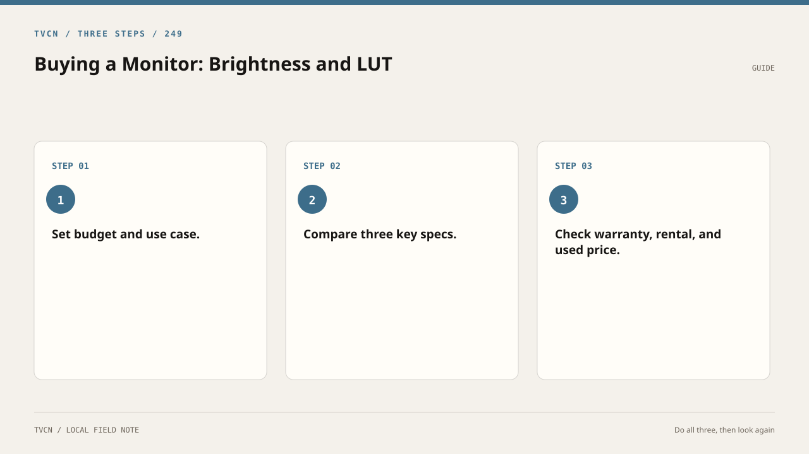

Check brightness, gamut, and LUT support; too dim outdoors is shooting blind.

<!-- DIAGRAM_START -->
<h2>Diagram</h2>
<figure>
  
  <figcaption>Do the three steps in order, then look again at the image or file.</figcaption>
</figure>
<!-- DIAGRAM_END -->
<h2>On set</h2>

Look for 1000 nits, Rec.709 coverage, and LUT support. Outdoor readability matters more than resolution.

<h2>Do this</h2>

Monitoring: brightness, gamut, and LUT support first. Without enough nits, outdoor work is blind.
<ol><li>At least 1000 nits and support for Rec.709 and HLG.</li><li>Waveform, false color, and LUTs, with ports that match your camera.</li><li>A hood and NP-F batteries; test it outdoors for ten minutes.</li></ol>
<h2>Avoid</h2>

Do not shop by resolution alone; if you cannot see it outdoors, 4K is useless.

<h2>Check</h2>
<ul><li>At least 1000 nits with Rec.709 and HLG support.</li><li>Waveform, false color, LUTs, and ports match the camera.</li><li>A hood and NP-F batteries were tested outdoors for ten minutes.</li></ul>
