<!-- DIAGRAM_START -->
<h2>Diagram</h2>
<figure>
  
  <figcaption>Diagram: throughput, rebuild, RAID, noise, and power decide whether it survives a studio.</figcaption>
</figure>
<!-- DIAGRAM_END -->
<h2>First decision: which link is missing</h2>
Calculate concurrency: how many editors on 4K? 10GbE is the floor; 1GbE is archive-only. RAID 5 suits four+ drives but rebuilds slowly; RAID 6 is safer. RAID is not backup; keep an offsite/offline copy. Size noise and cooling for the studio.

<strong>Fits:</strong>
<ul><li>Multicam/multi-editor</li><li>Long-term archive</li><li>Centralized backup</li></ul>
<strong>Does not fit:</strong>
<ul><li>Single-camera lightweight</li><li>RAID as the only copy</li><li>No UPS/ops</li></ul><h2>Test protocol: reproducible, no invented scores</h2>
Copy 100GB over 10GbE and log sustained speed. Pull a drive and measure rebuild time and performance drop. Listen at 1m in the studio. Cut power once and check UPS hold.

<table class="data-table"><thead><tr><th>Check</th><th>Pass line</th><th>Reference/log</th></tr></thead><tbody><tr><td>吞吐</td><td>10GbE 持续 500MB/s+</td><td>100GB 拷贝</td></tr><tr><td>重建</td><td>重建时间可接受，期间可工作</td><td>拔盘测试</td></tr><tr><td>RAID</td><td>RAID5/6 + 热备</td><td>配置检查</td></tr><tr><td>噪声</td><td>1 米不影响录音/工作</td><td>实测</td></tr><tr><td>供电</td><td>UPS 撑过短断电</td><td>断电测试</td></tr></tbody></table>
<h2>Price bands: total cost of ownership first</h2>
Look beyond the sticker: cards, batteries, adapters, gimbal, stands, software subscriptions, and repair. Bands describe the minimum kit for a real project type, not toy pricing.

<table class="data-table"><thead><tr><th>Tier</th><th>Reference</th><th>Includes</th><th>Watch</th></tr></thead><tbody><tr><td>Entry</td><td>¥3,000–8,000</td><td>2-bay NAS + 2×8TB</td><td>Limited throughput/redundancy</td></tr><tr><td>Main</td><td>¥8,000–20,000</td><td>4–6 bay + 10GbE + RAID5</td><td>Drives extra</td></tr><tr><td>Advanced</td><td>¥20,000–60,000</td><td>8+ bay, RAID6, UPS, offsite</td><td>Ops/power</td></tr></tbody></table>

Prices are China mainland channel references as of November 2026; tax and quotes vary. Not buying advice.
<h2>Alternatives and upgrades: do not add money on the wrong axis</h2><ul><li>DAS + two backups</li><li>Cloud + local drives</li><li>Rent post storage</li></ul><h2>Buying steps: bring footage, not spec sheets</h2>
Run these in order before paying. If one fails, do not tell yourself post will fix it.
<ol><li>Count concurrent editors</li><li>10GbE 100GB copy</li><li>Pull drive for rebuild</li><li>Listen at 1m</li><li>Cut power for UPS</li></ol><h2>Check</h2><ul><li>500MB/s+ on 10GbE.</li><li>Workable during rebuild.</li><li>RAID5/6 + hot spare.</li><li>Noise at 1m is acceptable.</li><li>UPS holds through a short cut.</li><li>Separate offsite/offline backup.</li></ul>
<!-- SOURCES_START -->
<h2>Sources</h2>

Experience: field notes and buying checklists; tested: short tests against public specs, not lab scores; references: manufacturer and standards links below.

<ul><li>[S23] SMPTE Standards</li><li>[S28] Netflix Partner Help</li></ul>

<a href="../../SOURCES.md">Full links and notes in SOURCES.md</a>

<!-- SOURCES_END -->
